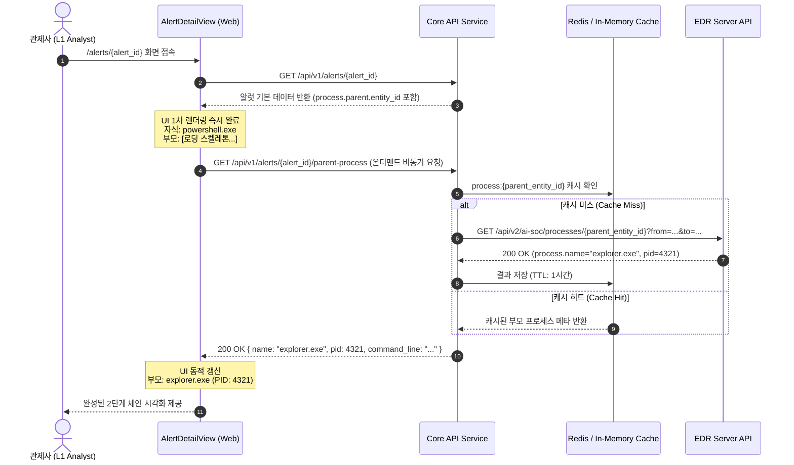

# [기능 명세서] EDR Alert 직계 부모 프로세스 온디맨드 지연 로딩 (On-Demand Direct Parent Process Lazy Loading)

* **문서 상태**: 검토 대기 (Draft)
* **작성 일자**: 2026-10-22
* **관련 모듈**: `apps/web/`, `services/api/`, `services/connectors/`
* **참조 명세**: `ai-soc/llm-rest-api-spec.md` (v1.0), `services/connectors/app/connectors/edrserver.py`
* **대상 이슈**: EDR 탐지 상세 화면에서 직계 부모 프로세스 정보 누락 해결 및 L1 트리아지 판정 가속화

---

## 1. 목적과 배경 (Objective & Context)

### 1.1 누구의 어떤 문제를 해결하는가?
* **문제 상황**:
  * 현재 EDR 알럿 수집 파이프라인(`edrserver.py`)은 대량 인제스트 성능을 위해 탐지 목록/상세 API(`GET /detections/{kind}/{id}`)까지만 수집합니다.
  * EDR 서버의 OCSF/ECS 명세(`llm-rest-api-spec.md`)상 탐지 상세 객체의 `process.parent`에는 식별자(`entity_id`)만 포함되고 부모 프로세스 이름(`parent.name`)이 누락되어 있습니다.
  * 이로 인해 관제사 화면(Alert Detail)의 탐지 근거 영역에 **"부모 프로세스 미확인"**으로 표시됩니다.
* **관제 업무 병목**:
  * `powershell.exe`, `cmd.exe`, `rundll32.exe` 같은 이중 용도(Dual-use/LOLBIN) 실행 알럿은 **직계 부모 프로세스(Direct Parent)가 오피스(`winword.exe`), 웹서버(`w3wp.exe`), 또는 정상 쉘(`explorer.exe`)인지에 따라 악성 여부가 90% 이상 판정**됩니다.
  * 부모 정보 부재 시 관제사는 단순 탐지 알럿을 무조건 Case 심층 조사로 에스컬레이션해야 하므로 MTTD(평균 탐지/판정 시간)가 크게 지연되고 알럿 피로도가 급증합니다.

### 1.2 목표 (Key Goals)
1. **L1 트리아지 즉시성 확보**: 관제사가 Alert Detail 화면 접속 시 직계 부모 프로세스의 실행 파일명, PID, 명령줄을 시각적으로 즉시 확인하여 1차 판정을 수 초 내에 완료.
2. **수집 파이프라인 오버헤드 0% (Zero-Ingest Impact)**: 커넥터 수집 루프(`fetch_alerts`)는 변경하지 않고 가볍게 유지하여, 수집 지연 및 EDR API Rate-limit(429) 위험을 원천 차단.
3. **엄격한 탐색 깊이 제한 (Strictly Bounded Scope)**: 부모의 조상까지 재귀 호출(Recursive Traversal)하지 않고, **딱 1-hop(직계 부모) 2단계 체인**으로 조회를 한정하여 지연 시간 폭증 방지.

---

## 2. 상용 제품 벤치마크 및 아키텍처 비교 (Commercial Benchmark)

| 비교 항목 | **Option A: 수집 시점 동기 인제스트** | **Option B: 에스컬레이션 시점 수집** | **Option C: 온디맨드 지연 로딩 (채택)** |
| :--- | :--- | :--- | :--- |
| **적용 시점** | 커넥터 폴링(`fetch_alerts`) 중 | Case 생성 후 심층 조사(Agent) 중 | **Alert Detail 화면 진입 시 (온디맨드)** |
| **상용 제품 대응** | 레거시 SIEM 배치 수집 | Cortex XDR / SOAR 자동 조사 | **CrowdStrike, SentinelOne, Defender** |
| **수집기 성능 영향** | **치명적 (N+1 증폭, 수집 지연)**<br>알럿 1,000건당 2,000회 HTTP 왕복 | **영향 없음** | **영향 없음 (0%)**<br>수집기는 그대로 통과 |
| **L1 관제 편의성** | 높음 (사전 로드됨) | **매우 낮음 (블라인드 트리아지)**<br>부모 확인 위해 매번 Case 생성 필요 | **매우 높음 (필요 알럿만 즉시 확인)** |
| **API 호출 횟수** | 인제스트된 **모든** 알럿 수 (낭비 발생) | 분석가가 에스컬레이션한 알럿 수 | **분석가가 실제로 열람한 알럿 1건당 1회** |

---

## 3. 기능 요구사항 및 동작 범위 (Scope)

### 3.1 포함 범위 (In-Scope)
1. **단 1-hop(직계 부모) 단발 조회**:
   * 대상: `rawEvent.process.parent.entity_id`가 존재하는 알럿.
   * 조회 대상: 직계 부모의 `process.name`, `process.executable`, `process.command_line`, `process.pid`.
2. **온디맨드 지연 로딩 (JIT Lazy Fetch)**:
   * Alert Detail 페이지(`/alerts/{id}`)가 마운트될 때 비동기로 부모 정보를 호출.
   * 백엔드 Core API에 프록시 및 캐시 엔드포인트(`GET /api/v1/alerts/{id}/parent-process`) 제공.
3. **인메모리/Redis 단기 캐싱**:
   * 동일 프로세스 UUID에 대한 중복 조회를 방지하기 위해 1시간(TTL 3600s) 캐싱 적용.
4. **반응형 UI 상태 관리**:
   * `Loading` (스켈레톤 펄스 애니메이션) → `Success` (부모 프로세스명 렌더링) → `Fallback` (실패 시 원본 entity_id 툴팁 유지).

### 3.2 제외 범위 (Non-Goals)
1. **조상(Grandparent/Ancestor) 재귀 탐색 금지**:
   * 부모의 부모를 꼬리 물기로 계속 호출하지 않음.
   * 전체 트리(Root까지) 조사는 Alert Detail의 범위가 아니며, 상단의 `Attack Graph` 및 `Case Process Tree` 전용 화면의 일괄 조회(`/investigations/.../graph`)로 위임.
2. **수집 커넥터(`edrserver.py`) 수정 금지**:
   * 수집 파이프라인의 안전성과 처리량을 위해 커넥터 폴링 단계에는 어떠한 2차 호출도 추가하지 않음.

---

## 4. 데이터 흐름 및 시퀀스 (Data Flow & Sequence)



---

## 5. 상세 인터페이스 및 API 명세 (API Specification)

### 5.1 EDR 원천 API 규격 (참조: `llm-rest-api-spec.md` 12.3항)
* **엔드포인트**: `GET /api/v2/ai-soc/processes/{process_id}`
* **필수 쿼리 파라미터**:
  * `from`: 알럿 발생 시각 기준 `-24시간` (RFC 3339 UTC)
  * `to`: 알럿 발생 시각 기준 `+1시간` (현재 시각 초과 금지)
* **원천 응답 객체 (`process-detail-v1`)**:
  ```json
  {
    "process": {
      "entity_id": "65047b5e-4289-4229-9840-018a31e5d4c2",
      "pid": 4321,
      "name": "explorer.exe",
      "executable": "C:\\Windows\\explorer.exe",
      "command_line": "C:\\Windows\\explorer.exe",
      "start": "2026-10-22T03:00:10.000Z"
    }
  }
  ```

### 5.2 AiSOC 신규 백엔드 API 명세
* **Path**: `GET /api/v1/alerts/{alert_id}/parent-process`
* **인증**: Bearer JWT (`alerts:read` 권한 필요)
* **응답 모델 (`ParentProcessResponse`)**:
  ```json
  {
    "status": "resolved",
    "entity_id": "65047b5e-4289-4229-9840-018a31e5d4c2",
    "name": "explorer.exe",
    "pid": 4321,
    "executable": "C:\\Windows\\explorer.exe",
    "command_line": "C:\\Windows\\explorer.exe",
    "cached": false
  }
  ```
* **오류 및 예외 응답**:
  * 부모 식별자가 없는 알럿: `{"status": "no_parent", "entity_id": null}` (200 OK)
  * EDR 서버 404/미등록 프로세스: `{"status": "not_found", "entity_id": "..."}` (200 OK)
  * EDR 서버 연동 장애: `{"status": "unavailable", "entity_id": "..."}` (200 OK)
  * *원칙: 부모 프로세스 조회 실패가 알럿 상세 화면 전체 에러(500)로 전파되지 않도록 200 기반 Graceful Degradation 유지.*

---

## 6. 프론트엔드 UI/UX 명세 (`apps/web`)

### 6.1 탐지 근거 섹션 (`DetectionBasisSection`) 상태별 UI

1. **초기 로딩 상태 (`status: 'loading'`)**:
   ```text
   • 프로세스: powershell.exe
   • 부모 프로세스: [ ====== 펄스 스켈레톤 바 ====== ]
   • 명령줄: powershell.exe -enc ...
   ```
2. **해결 성공 상태 (`status: 'resolved'`)**:
   ```text
   • 프로세스: powershell.exe
   • 부모 프로세스: explorer.exe (PID: 4321)
   • 명령줄: powershell.exe -enc ...
   ```
   * 부모 프로세스명 클릭 또는 마우스 호버 시 툴팁으로 부모 실행 경로(`C:\Windows\explorer.exe`) 및 Entity ID 표기.
3. **조회 실패/부재 상태 (`status: 'not_found' | 'no_parent' | 'unavailable'`)**:
   ```text
   • 프로세스: powershell.exe
   • 부모 프로세스: 부모 프로세스 미확인 (ID: 65047b5e...)
   • 명령줄: powershell.exe -enc ...
   ```
   * 괄호 안에 단축 Entity ID를 표기하고, 마우스 호버 시 원본 UUID 전체 복사 지원.

---

## 7. 보안 및 방어적 제어 (Security & Guardrails)

1. **자동 링크 방지 (No Auto-linking)**:
   * 지연 로딩된 부모 실행 파일명(`explorer.exe`)이나 경로(`C:\Windows\...`) 역시 `<a href>` 링크로 변환하지 않고 순수 텍스트(`<span>`, `<code>`)로만 렌더링.
2. **명령줄 디팽(Defang) 일관성**:
   * 부모 프로세스의 명령줄(`command_line`)이 노출될 경우 기존 ⑤ 탐지 근거 보안 규칙과 동일하게 1024자 절삭 및 디팽 적용.
3. **비동기 격리 (Failure Isolation)**:
   * 부모 프로세스 지연 로딩 API가 지연되거나 타임아웃(3초)되더라도 한 줄 요약, 판단 메타, 영향 자산 등 나머지 섹션의 렌더링은 블로킹되지 않음.
4. **EDR 서버 부하 완화 (Throttling)**:
   * 백엔드 API는 동일한 EDR 서버에 대해 프로세스 조회 동시성을 최대 5개로 제한(`asyncio.Semaphore(5)`).

---

## 8. 수용 기준 (Acceptance Criteria)

| ID | 수용 기준 (Given / When / Then) | 검증 방법 |
| :--- | :--- | :--- |
| **AC-LP-1** | `parent.entity_id`가 있는 알럿 상세 화면에 접속했을 때, 부모 프로세스 항목에 일시적인 로딩 상태가 표시된 후 EDR 조회를 거쳐 부모 프로세스명(`explorer.exe`)이 정상 렌더링된다. | E2E 컴포넌트 렌더링 테스트 |
| **AC-LP-2** | 부모 프로세스 조회 API가 실패하거나 EDR 서버가 404를 반환해도 화면에 에러 배너가 발생하지 않고 `"부모 프로세스 미확인 (단축 ID)"`으로 우아하게 폴백된다. | 단위 테스트 (Mock 404/503) |
| **AC-LP-3** | 커넥터 수집 프로세스(`edrserver.py`)의 폴링 소요 시간 및 배치 수집 로직에 일체의 추가 HTTP 요청이 발생하지 않는다. | 커넥터 단위 테스트 및 네트워크 모니터링 |
| **AC-LP-4** | 동일 알럿 상세 화면을 재방문하거나 새로고침할 때 캐시(Cache Hit)를 통해 EDR 원천 서버로의 중복 요청이 발생하지 않는다. | 백엔드 API 캐시 적중 로그 확인 |
| **AC-LP-5** | 부모 프로세스의 조상(2-hop 이상)을 조회하는 추가 재귀 요청이 일체 발생하지 않는다. (호출 스코프 1-hop 엄격 제한) | HTTP 요청 카운트 단언 테스트 |
