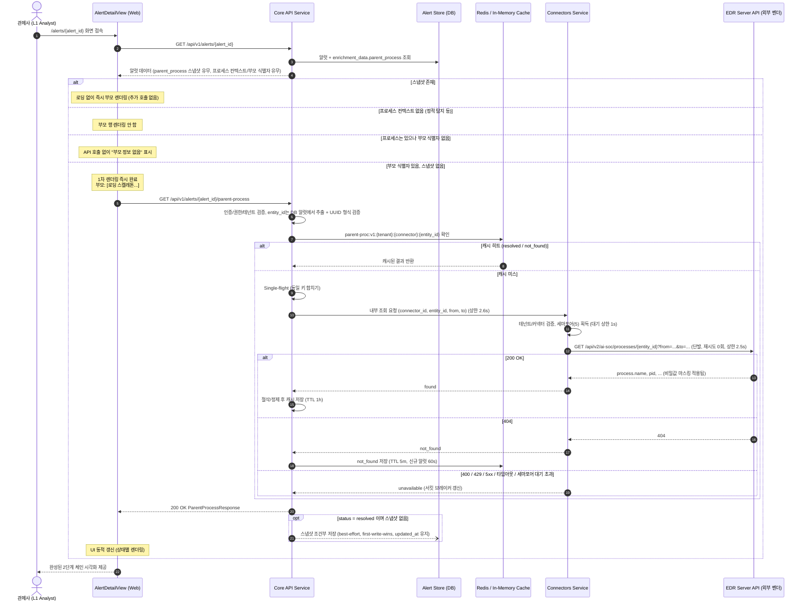

# [기능 명세서] EDR Alert 직계 부모 프로세스 온디맨드 지연 로딩 (On-Demand Direct Parent Process Lazy Loading)

* **문서 상태**: 검토 대기 (Draft) — v1.6 (PoC 보류 전제 반영본)
* **작성 일자**: 2026-10-22
* **관련 모듈**: `apps/web/`, `services/api/`, `services/connectors/`
* **참조 명세**: `ai-soc/llm-rest-api-spec.md` (v1.0), `services/connectors/app/connectors/edrserver.py`
* **대상 이슈**: EDR 탐지 상세 화면에서 직계 부모 프로세스 정보 누락 해결 및 L1 트리아지 판정 가속화
* **표기 규칙**: `[보강]` = v1.0에 없던 신규 내용, `[수정]` = v1.0의 내용을 바로잡은 부분, `[v1.2]` = 결과 영속화 관련 추가/변경, `[v1.3]` = 미결 사항 조사 결과 반영, `[v1.4]` = 2차 조사 결과 반영, `[v1.5]` = 설계 결정(5.4절 (b)안 채택, `edrserver` 출처 한정) 반영, `[v1.6]` = EDR PoC를 당분간 수행할 수 없다는 전제 반영(13절). 조사 결과는 에이전트의 코드/데이터 대조에 기반하며, 확인되지 않은 항목은 본문과 부록 C에 "미확인"으로 표시했습니다. 변경 내역 전체는 부록 A 참조.

---

## 1. 목적과 배경 (Objective & Context)

### 1.1 누구의 어떤 문제를 해결하는가?
* **문제 상황**:
  * 현재 EDR 알럿 수집 파이프라인(`edrserver.py`)은 대량 인제스트 성능을 위해 탐지 목록/상세 API(`GET /detections/{kind}/{id}`)까지만 수집합니다.
  * EDR 서버의 OCSF/ECS 명세(`llm-rest-api-spec.md`)상 탐지 상세 객체의 `process.parent`에는 식별자(`entity_id`)만 포함되고 부모 프로세스 이름(`parent.name`)이 누락되어 있습니다.
  * 이로 인해 관제사 화면(Alert Detail)의 탐지 근거 영역에 **"부모 프로세스 미확인"**으로 표시됩니다.
  * `[v1.4]` 현재 적재된 알럿 263건 기준 **최신 집계**: `parent.entity_id` 보유 252건(96.0%), 부재 11건(4.0%, 주로 정적 탐지·파일 생성 이벤트 등 프로세스 컨텍스트가 없는 경우), `parent.name`·`parent.start` 보유 0건. 단, 1차 집계(215건·81.7%)와 **불일치**한다. 1차 집계가 중첩 경로(`raw_event.raw_data` 내부)를 누락했을 가능성이 있으나 확인되지 않았으므로 재검증한다(OQ-12).
* **관제 업무 병목**:
  * `powershell.exe`, `cmd.exe`, `rundll32.exe` 같은 이중 용도(Dual-use/LOLBIN) 실행 알럿은 **직계 부모 프로세스(Direct Parent)가 오피스(`winword.exe`), 웹서버(`w3wp.exe`), 또는 정상 쉘(`explorer.exe`)인지**가 악성 여부 판정의 가장 강력한 단서입니다. `[수정]` v1.0의 "90% 이상 판정"은 근거 자료가 없으므로 정성 표현으로 대체하고, 실제 수치는 도입 후 측정(8.2절 성공 지표)으로 확보합니다.
  * 부모 정보 부재 시 관제사는 단순 탐지 알럿도 Case 심층 조사로 에스컬레이션해야 하므로 **트리아지 소요 시간(MTTT, Mean Time To Triage)**이 지연되고 알럿 피로도가 급증합니다. `[수정]` v1.0의 MTTD(탐지 시간)는 본 문제의 지표가 아니므로 MTTT로 정정합니다.

### 1.2 목표 (Key Goals)
1. **L1 트리아지 즉시성 확보**: 관제사가 Alert Detail 화면 접속 시 직계 부모 프로세스의 실행 파일명, PID, 명령줄을 즉시 확인하여 1차 판정을 수 초 내에 완료. `[v1.6]` PoC 보류 전제에서 1단계는 실행 파일명·경로·PID를 우선하고, 부모 명령줄은 마스킹 확인 후 활성화한다(13.4절).
2. **수집 파이프라인 오버헤드 0% (Zero-Ingest Impact)**: 커넥터 수집 루프(`fetch_alerts`)는 변경하지 않고 가볍게 유지하여, 수집 지연 및 EDR API Rate-limit(429) 위험을 원천 차단.
3. **엄격한 탐색 깊이 제한 (Strictly Bounded Scope)**: 부모의 조상까지 재귀 호출하지 않고, **직계 부모 1-hop 단일 호출**로 한정하여 지연 시간 폭증 방지.
4. **[보강] 안전한 격리와 우아한 저하**: 부모 조회의 어떤 실패도 알럿 상세 화면의 다른 기능에 영향을 주지 않으며, EDR 서버에 과부하를 유발하지 않는다.
5. **[v1.2] 조회 결과의 보존과 재사용**: 한 번 확인한 부모 프로세스 정보는 알럿에 스냅샷으로 저장하여, EDR 보존 기간·장애와 무관하게 재열람하고 Case 증적과 향후 검색/자동화에 재사용할 수 있게 한다.

---

## 2. 상용 제품 벤치마크 및 아키텍처 비교 (Commercial Benchmark)

| 비교 항목 | **Option A: 수집 시점 동기 인제스트** | **Option B: 에스컬레이션 시점 수집** | **Option C: 온디맨드 지연 로딩 (채택)** |
| :--- | :--- | :--- | :--- |
| **적용 시점** | 커넥터 폴링(`fetch_alerts`) 중 | Case 생성 후 심층 조사(Agent) 중 | **Alert Detail 화면 진입 시 (온디맨드)** |
| **상용 제품 대응** | 레거시 SIEM 배치 수집 | Cortex XDR / SOAR 자동 조사 (미검증) | **대응 사례 없음** `[수정]` (아래 주석 참조) |
| **수집기 성능 영향** | **치명적 (N+1 증폭, 수집 지연)**<br>알럿 1,000건당 **1,000회**의 추가 HTTP 왕복 `[수정]` | **영향 없음** | **영향 없음 (0%)**<br>수집기는 그대로 통과 |
| **L1 관제 편의성** | 높음 (사전 로드됨) | **매우 낮음 (블라인드 트리아지)**<br>부모 확인 위해 매번 Case 생성 필요 | **매우 높음 (필요 알럿만 즉시 확인)** |
| **API 호출 횟수** | 인제스트된 **모든** 알럿 수 (낭비 발생) | 분석가가 에스컬레이션한 알럿 수 | **분석가가 실제로 열람한 알럿 1건당 최대 1회 (캐시 적중 시 0회)** |
| **데이터 보존성** `[보강]` | 알럿과 함께 영구 저장 | Case 증적으로 저장 | **첫 조회 성공 시 알럿에 스냅샷 저장 (3.3절)** — 열람한 알럿에 한해 보존 |

> `[수정]` v1.0의 "알럿 1,000건당 2,000회"는 1-hop 단일 호출 가정(알럿당 1회)과 맞지 않아 1,000회로 정정했습니다.

> `[v1.3 수정]` **벤치마크 해석 정정**: 에이전트 조사에 따르면 CrowdStrike(`ProcessRollup2`의 `ParentBaseFileName` 등), Microsoft Defender(`DeviceProcessEvents`의 `InitiatingProcess*`), SentinelOne(Threats API의 부모 프로세스 표시명)은 모두 **탐지/이벤트 레코드 자체에 부모 정보를 원천 포함**합니다. 이는 소비 측이 따로 조회하지 않아도 되는 "원천 제공" 사례이지, Option C(온디맨드 지연 로딩)의 근거가 아닙니다. 따라서 v1.2까지의 "Option C = 상용 제품 방식" 표기를 삭제했습니다. 단, 위 내용은 공식 문서 URL이 확보되지 않은 **미검증** 상태입니다(OQ-7).
>
> **Option D (벤더 기능 요청, 장기·비보장)** `[v1.4]`: 위 사례가 맞다면 가장 근본적인 해법은 EDR 서버의 탐지 상세 응답에 부모 요약(`name`, `executable`, `pid`)을 포함시키는 것입니다. 그러나 `[v1.4 확인]` EDR 서버는 **외부 벤더 제품(Somansa EdrServer)**이어서 AiSOC 저장소에서 수정할 수 없고 제공된 REST API 계약대로만 연동해야 합니다. 따라서 Option D는 벤더에 대한 기능 요청으로만 가능하며 일정을 보장할 수 없습니다. 본 명세(Option C + 영속화)는 이 제약 하의 **현실적인 해법**입니다.

---

## 3. 기능 요구사항 및 동작 범위 (Scope)

### 3.1 포함 범위 (In-Scope)
1. **단 1-hop(직계 부모) 단발 조회**:
   * 대상: 알럿 저장 데이터(`rawEvent`)에 `process.parent.entity_id`가 존재하는 EDR 알럿.
   * 조회 대상: 직계 부모의 `process.name`, `process.executable`, `process.command_line`, `process.pid`, `process.start`.
2. **온디맨드 지연 로딩 (JIT Lazy Fetch)**:
   * Alert Detail 페이지(`/alerts/{id}`)가 마운트될 때 비동기로 부모 정보를 호출.
   * 백엔드 Core API에 프록시 및 캐시 엔드포인트(`GET /api/v1/alerts/{id}/parent-process`) 제공.
3. **인메모리/Redis 단기 캐싱**: 3.4절 캐시 정책에 따름.
   * `[v1.2]` 알럿별 영속 스냅샷(3.3절)이 있으면 그것을 우선 사용하고, 없을 때만 캐시/EDR을 조회한다.
4. **반응형 UI 상태 관리**:
   * `Loading` (스켈레톤 펄스 애니메이션) → `Success` (부모 프로세스명 렌더링) → `Fallback` (실패 시 상태별 안내) — 6절 참조.
5. **[보강] 적용 대상 판별 규칙**:
   * EDR 커넥터에서 수집된 알럿에만 적용. 타 소스(SIEM, 클라우드 등) 알럿은 부모 프로세스 행 자체를 렌더링하지 않는다.
   * `[v1.5 결정]` 적용 대상 판별 기준은 알럿의 **`connector_type = "edrserver"`**이며, 구체 인스턴스는 `connector_id`로 식별한다. 이 게이트는 3곳에서 적용한다: ① 알럿 응답이 부모 조회 대상 여부를 서버 판정값으로 내려 UI가 부모 행 렌더링과 `parent-process` 호출 여부를 결정, ② API가 `parent-process` 요청 시 `connector_type`을 재검증하고 비대상이면 EDR/커넥터 서비스를 호출하지 않고 `not_applicable`을 반환, ③ 커넥터 서비스가 요청의 `connector_id`가 해당 테넌트 소유의 `edrserver` 유형인지 재검증. 다른 커넥터 유형의 부모 조회 지원은 본 명세의 범위가 아니다.
   * `rawEvent.process.parent.name`이 **이미 존재**하면 EDR 조회를 생략하고 해당 값을 `source: "inline"`으로 반환한다(불필요한 호출 제거). `[v1.3]` 현재 적재 데이터에서 이 비율은 0%(263건 기준)이므로 방어적 분기로만 구현하고 우선순위는 낮춘다.
   * 부모 `entity_id`가 해당 프로세스 자신의 `entity_id`와 동일한 경우(자기 참조/루프)는 `no_parent`로 처리한다.
   * 알럿에 프로세스 이벤트가 여럿인 경우 **알럿의 주(primary) 탐지 프로세스**의 부모만 대상으로 한다.
   * `[v1.4]` **프로세스 컨텍스트가 없는 알럿**(정적 탐지, 파일 생성 이벤트 등)은 부모 조회 대상이 아니며 UI에서 부모 행을 렌더링하지 않는다.
   * `[v1.4 확인]` 부모 식별자 경로는 동적 탐지에서 `raw_event.process.parent.entity_id` 또는 `raw_event.raw_data` 내 중첩 구조로 나타난다. 서버는 **두 경로를 모두 처리하는 단일 추출 함수**(`extract_parent_entity_id`)를 사용하고, 프런트엔드는 추출을 직접 하지 않고 서버가 판정한 결과만 사용한다.
6. **[v1.2] 결과 영속화 (Write-back)**: `resolved` 결과는 해당 알럿에 스냅샷으로 저장한다 (3.3절).

### 3.2 제외 범위 (Non-Goals)
1. **조상(Grandparent/Ancestor) 재귀 탐색 금지**:
   * 부모의 부모를 꼬리 물기로 계속 호출하지 않음.
   * 전체 트리(Root까지) 조사는 Alert Detail의 범위가 아니며, `Attack Graph` 및 `Case Process Tree` 전용 화면의 일괄 조회(`/investigations/.../graph`)로 위임.
2. **수집 커넥터(`edrserver.py`) 수정 금지**:
   * 수집 파이프라인의 안전성과 처리량을 위해 커넥터 폴링 단계에는 어떠한 2차 호출도 추가하지 않음.
   * `[v1.4 명확화]` 금지 범위는 **폴링 경로(`fetch_alerts`)의 코드와 동작**이다. 부모 조회를 커넥터 서비스에서 수행하는 안(5.4절)을 채택하면 폴링과 무관한 **별도 조회 메서드/내부 엔드포인트의 추가**는 허용하되, 폴링 경로는 변경하지 않는다(AC-LP-3).
3. **[보강] 기타 비목표**:
   * 알럿 목록 화면(리스트)에서의 부모 프로세스 일괄 표시/프리페치.
   * 자식 프로세스, 네트워크/파일 이벤트 등 부모 외 연관 엔티티 조회.
   * 부모 프로세스 기반 자동 판정(스코어링/룰) — 본 기능은 정보 표시와 저장에 한정.
   * `[v1.2]` 열람되지 않은 알럿의 사전 채움(백필)과 비동기 보강 워커 — 2단계(12절)에서 별도 명세.
   * `[v1.2]` 검색/필터/룰 엔진 연동 — 저장 필드는 이를 대비해 설계하되 1차 릴리스에서는 노출하지 않음 (커버리지 편향, 3.3절 참조).

### 3.3 [v1.2] 결과 영속화 (Write-back) — 1차 릴리스 포함
* **문제**: 지연 로딩만으로는 값이 UI 표시에만 쓰이고 저장되지 않습니다. 캐시 TTL(1시간) 이후, 또는 EDR 서버의 데이터 보존 기간이 지나거나 장애 중일 때는 과거 알럿의 부모 정보를 다시 볼 수 없고, Case 증적·검색·자동화에도 쓸 수 없습니다.
* **결정**: `resolved` 결과를 알럿에 **불변 스냅샷**으로 1회 저장하고, 이후 모든 조회는 스냅샷을 우선 사용한다.

| 항목 | 정책 |
| :--- | :--- |
| **저장 대상** | `status = resolved` 이며 `source = edr_lookup` 인 결과만. `not_found`/`unavailable`/`no_parent`는 저장하지 않는다(일시적이거나 파생 가능한 상태). `inline`(이미 원본 이벤트에 있음)도 저장 불필요 |
| **저장 위치** | `[v1.3 확인]` 기존 컬럼 **`alerts.enrichment_data` (JSONB)** 내 `parent_process` 객체. 신규 테이블/마이그레이션 불필요 (Fusion/Alert Rail이 이미 같은 컬럼에 보강 데이터를 기록 중) |
| **쓰기 방식** `[v1.3]` | **원자적 단일 SQL**로 병합: `UPDATE alerts SET enrichment_data = enrichment_data \|\| jsonb_build_object('parent_process', :snapshot) WHERE id = :id AND NOT (enrichment_data ? 'parent_process')`. 애플리케이션에서 dict를 읽어 수정 후 컬럼 전체를 대입하는 방식은 **금지** (다른 기록자와의 lost update 방지) |
| **쓰기 부작용** `[v1.4]` | `[v1.4 확인]` ORM 설정상 알럿 UPDATE 시 `updated_at`이 자동 갱신된다. 스냅샷 저장은 **`updated_at`을 갱신하지 않도록** 명시 처리한다(SQLAlchemy Core에서 `updated_at`을 기존 값으로 명시 지정하면 `onupdate`가 적용되지 않음. 구현 시 실제 동작으로 검증). 알럿 UPDATE만으로는 에이전트가 재실행되지 않음(확인). DB 트리거·CDC·이벤트 발행 여부는 **미확인**(OQ-15) |
| **호출 의미** `[v1.4]` | `parent-process`는 GET이지만 캐시 채움 성격의 멱등 쓰기를 수행한다. 이 쓰기는 사용자 권한(`alerts:read`)이 아니라 **서비스 신원**으로 수행하고, 해당 API 경로가 읽기 전용 DB 세션/읽기 복제본을 쓰지 않는지 확인한다(OQ-16). 문제가 되면 저장만 별도 내부 작업(백그라운드 태스크/큐)으로 분리한다 |
| **저장 시점** | EDR 조회 성공(또는 Redis 캐시 히트) 직후, **응답 반환을 막지 않는 best-effort**로 기록. 저장 실패는 사용자 응답에 영향 없음(지표/로그만), 다음 조회 시 재시도 |
| **캐시 히트 시** | 같은 부모를 공유하는 **다른 알럿**이 캐시 히트로 응답받더라도, 해당 알럿에 스냅샷이 없으면 저장한다(EDR 호출은 추가로 발생하지 않음) |
| **동시성/멱등** | 조건부 갱신(`parent_process`가 비어 있을 때만 기록) — first-write-wins. 동시 요청이 와도 1건만 저장되고 기존 스냅샷을 덮어쓰지 않음 |
| **불변성** | 부모 프로세스 정보는 과거 사실이므로 스냅샷은 갱신하지 않는다. 재조회·재검증 로직 없음 |
| **저장 값** | 서버에서 **제어문자 정제를 마친 값만** 저장(7절). `[v1.6]` PoC 보류 전제에서 **부모 `command_line`은 1단계에서 조회·응답·캐시·저장 모두에서 제외**한다(설정 `PARENT_LOOKUP_INCLUDE_COMMAND_LINE`, 기본 off, 활성 조건은 13.4절). 활성 시에는 1024자 절삭을 적용 |
| **출처 정보** | `fetched_at`, `connector_id`, `lookup_window(from,to)`, `schema_version`을 함께 저장하여 사후 감사·재현 가능 |
| **수명** | 알럿과 동일한 라이프사이클. 알럿 삭제·보존기간 만료·테넌트 삭제 시 함께 삭제 |
| **권한** | 알럿 조회와 동일한 `alerts:read` 및 테넌트 격리 규칙 |
| **Case 승계** | 알럿이 Case로 에스컬레이션될 때 스냅샷을 증적에 복사. 스냅샷이 없으면 복사하지 않으며 이를 위해 EDR을 추가 호출하지 않는다 |

* **커버리지 한계 (중요)**: 스냅샷은 **관제사가 열람한 알럿에만** 존재합니다. 따라서 "스냅샷 없음"은 "부모 없음"이 아니라 **"미조회(unknown)"**를 뜻하며, 탐지 룰 판정이나 통계의 근거로 단독 사용해서는 안 됩니다. 전수 채움이 필요하면 2단계(12절)의 비동기 보강이 선행되어야 합니다.
* **[v1.4] 자동 트리아지와의 시점 불일치**: 파이프라인은 Ingest → Kafka(`aisoc.alerts.fused`) → Fusion → 에이전트 워커(`FusedAlertTriageWorker`)이고, 에이전트는 DB/Kafka로 전달받은 `raw_alert`만 참조한다(네트워크 호출 없음). 스냅샷은 관제사가 알럿을 연 뒤에야 생성되므로 1단계 결과는 에이전트의 자동 트리아지에 **반영되지 않는다.** 2단계에서 부모를 채우려면 에이전트가 소비하는 **메시지 페이로드에 포함되기 전에** 채우거나, 에이전트가 DB를 재조회하는 구조여야 한다(삽입 위치는 OQ-18).
* **후속 활용을 위한 설계 고려**: 저장 필드는 향후 검색/필터를 위해 정규화된 소문자 이름(`name_normalized`)을 파생 저장할 수 있도록 스키마에 여지를 둔다(1차 릴리스에서는 노출하지 않음).

### 3.4 [보강] 캐시 정책
| 항목 | 정책 |
| :--- | :--- |
| **조회 우선순위** `[v1.2]` | ① 알럿 영속 스냅샷(DB) → ② Redis 캐시 → ③ EDR 호출. Redis는 같은 부모를 공유하는 다른 알럿 조회, `not_found` 음성 캐시, Single-flight 용도로 유지 |
| **캐시 키** | `parent-proc:v1:{tenant_id}:{connector_id}:{entity_id}` — **테넌트/커넥터 범위를 반드시 포함** (다중 테넌트 간 데이터 노출 및 EDR 인스턴스 간 UUID 충돌 방지) |
| **`resolved` TTL** | 3600초 |
| **`not_found` TTL** | 300초. 단 EDR은 최종 일관성(`consistency: eventual`, 명세서 1.18항)이므로 **알럿 생성 후 10분 미만이면 60초**로 단축 (인덱싱 지연으로 인한 일시적 404 대응. 10분은 초기값이며 지연 상한 확인 후 조정, OQ-9) |
| **`unavailable`** | **캐시하지 않음.** 대신 커넥터 단위 서킷 브레이커(30초)로 재시도 폭주 방지 |
| **`no_parent`** | 로컬에서 판정되므로 캐시/호출 없음 |
| **동시 요청 합치기 (Single-flight)** | 동일 키에 대한 동시 miss 요청은 1회의 EDR 호출로 합치고 결과를 공유 |
| **저장 데이터** | 서버에서 절삭·정제를 마친 값만 저장(7.3절). 원본 명령줄 전체는 저장하지 않음 |
| **HTTP 헤더** | 응답에 `Cache-Control: private, no-store` (브라우저/프록시 캐시 방지). 프론트 캐시는 클라이언트 쿼리 캐시(예: staleTime 60초)로 관리 |

---

## 4. 데이터 흐름 및 시퀀스 (Data Flow & Sequence)




---

## 5. 상세 인터페이스 및 API 명세 (API Specification)

### 5.1 EDR 원천 API 규격 (참조: `llm-rest-api-spec.md` 12.3항)
* **호출 주체** `[v1.4]`: EDR 자격증명은 `connectors` 테이블에 암호화 저장되어 `services/connectors`의 `EdrServerConnector`만 사용하며, `services/api`에는 EDR 직접 호출 경로가 없다. 호출 경로는 5.4절 참조.
* **엔드포인트**: `GET /api/v2/ai-soc/processes/{process_id}`
* **필수 쿼리 파라미터**: `from`, `to` (RFC 3339 UTC)
  * `[v1.3 확인]` `from/to`는 `process.start` 필터가 아니라 **조회할 Elasticsearch 인덱스 파티션(`edr_*`)을 선택하는 기준**이다(명세서 19항). 최대 조회 범위는 capabilities의 `max_process_lookup_range_minutes` = **10,080분(7일)**(명세서 7.1항), 그리고 `to <= now() + 1m`.
  * **규칙**: `to = min(알럿 발생 시각 + 1시간, 현재 시각)`, `from = to − (max_range − 5분)`. 즉 허용되는 최대 범위를 5분 여유를 두고 사용한다. `max_range`는 capabilities에서 읽어 캐시하되, 읽지 못하면 10,080분을 기본값으로 쓴다.
  * `[v1.3 수정]` v1.2의 "알럿 시각 −7일 ~ +1시간"은 총 범위가 7일 1시간으로 상한을 초과하므로 폐기한다. 부모 `process.start` 기반 `from` 규칙도 현재 데이터에서 0%라 제거한다.
  * **미확정 (OQ-1 잔여)**: 파티션 선택 기준이라는 사실만으로는 *7일보다 오래전에 시작해 계속 실행 중인* 부모가 조회되는지가 확정되지 않는다(문서가 시작 시점 파티션에만 있는지, 이후 파티션에도 존재하는지 불명). 실증 전까지 R-1을 유지한다. 또한 윈도우가 길수록 지연이 늘 수 있어 PoC에서 1일 vs 7일 윈도우의 지연을 측정한다.
  * 호출은 **항상 1회**이며, 윈도우 확대용 재시도(2차 호출)는 하지 않는다(AC-LP-5 유지).
  * `[v1.6]` PoC 보류 전제에서 윈도우 길이는 설정값 `PARENT_LOOKUP_WINDOW_MINUTES`(기본: 허용 최대 범위 − 5분)로 두어 재배포 없이 조정할 수 있게 한다. 기본값을 최대로 잡는 이유는 장기 실행 부모를 찾을 가능성을 최대화하기 위함이며, 지연이 크면 타임아웃으로 `unavailable`로 안전하게 저하된다.
* **원천 응답 객체 (`process-detail-v1`)**:
  ```json
  {
    "process": {
      "entity_id": "65047b5e-4289-4229-9840-018a31e5d4c2",
      "pid": 4321,
      "name": "explorer.exe",
      "executable": "C:\\Windows\\explorer.exe",
      "command_line": "C:\\Windows\\explorer.exe",
      "start": "2026-10-22T03:00:10.000Z"
    }
  }
  ```
* **[보강] 원천 응답 처리 규칙**:
  | EDR 응답 | AiSOC 상태 | 비고 |
  | :--- | :--- | :--- |
  | 200 + `process.name` 존재 | `resolved` | |
  | 200 + `process` 객체 비었거나 `name` 없음 | `not_found` | 스키마 불일치는 경고 로그 |
  | 404 | `not_found` | |
  | 401/403 (커넥터 자격증명 문제) | `unavailable` | 운영자 알림용 에러 로그 (자격증명 값 로깅 금지) |
  | 429 | `unavailable` | `Retry-After` 값만큼 서킷 브레이커 유지, 내부 재시도 금지 |
  | 400 `invalid_request` (`query_too_broad`: 범위 초과) `[v1.4 확인]` | `unavailable` | 설정/구현 오류로 간주, 운영 알림 |
  | 5xx / 네트워크 오류 / 타임아웃 | `unavailable` | |

### 5.2 AiSOC 신규 백엔드 API 명세
* **Path**: `GET /api/v1/alerts/{alert_id}/parent-process`
* **인증**: Bearer JWT (`alerts:read` 권한 필요)
* **[보강] 인가 규칙**:
  * `alert_id`가 호출자 테넌트 소속인지 검증한다. 소속이 아니거나 존재하지 않으면 `404`(존재 여부 비노출).
  * **`entity_id`는 클라이언트 입력으로 받지 않는다.** 서버가 저장된 알럿 데이터에서만 추출하며, EDR URL 경로에 사용하기 전 UUID 형식(정규식/파서)으로 검증한다. 검증 실패 시 `not_found`로 처리하고 EDR 호출 금지 (경로 주입/SSRF 방지).
  * EDR 접속 정보(base URL, 자격증명)는 알럿의 출처 커넥터 설정에서만 가져온다. `[v1.3]` EDR 클라이언트·자격증명이 `services/connectors`에 있으므로, `services/api`가 EDR을 호출하는 경로(커넥터 서비스에 위임 / 공용 클라이언트 모듈 / 내부 프록시)는 **OQ-11에서 확정**한다.
* **응답 모델 (`ParentProcessResponse`)** `[보강: 필드 확장]`:
  ```json
  {
    "status": "resolved",
    "entity_id": "65047b5e-4289-4229-9840-018a31e5d4c2",
    "name": "explorer.exe",
    "pid": 4321,
    "executable": "C:\\Windows\\explorer.exe",
    "command_line": "C:\\Windows\\explorer.exe",
    "command_line_truncated": false,
    "started_at": "2026-10-22T03:00:10.000Z",
    "source": "edr_lookup",
    "cached": false,
    "fetched_at": "2026-10-22T03:12:45.120Z"
  }
  ```
* **[보강] 상태별 필드 규칙**:
  | status | entity_id | name/pid/executable/command_line/started_at | source | 비고 |
  | :--- | :--- | :--- | :--- | :--- |
  | `resolved` | 문자열 | 존재(없는 필드는 `null`) | `edr_lookup` \| `inline` \| `persisted` | `cached`로 캐시 여부 표시 |
  | `not_found` | 문자열 | 모두 `null` | — | |
  | `unavailable` | 문자열 | 모두 `null` | — | `retryable: true` 포함 |
  | `no_parent` | `null` | 모두 `null` | — | 부모 식별자 없음/자기 참조 |
  | `not_applicable` `[v1.5]` | `null` | 모두 `null` | — | 비대상 알럿(출처 커넥터가 `edrserver`가 아니거나 프로세스 컨텍스트가 없음). UI는 부모 행을 렌더링하지 않음 |
* **HTTP 상태 코드 원칙** `[수정]`:
  * 부모 조회 **결과**(`resolved`/`not_found`/`unavailable`/`no_parent`)는 모두 `200 OK` + `status`로 표현 (Graceful Degradation).
  * 그러나 **요청 자체의 문제**는 표준 코드를 사용: `401`(미인증), `403`(권한 없음), `404`(알럿 없음/타 테넌트), `429`(AiSOC API 자체의 호출 제한). 프론트엔드는 이를 부모 행 오류가 아닌 공통 오류 처리 경로로 넘긴다.

### 5.3 [v1.2] 알럿 응답의 부모 프로세스 스냅샷
* `GET /api/v1/alerts/{alert_id}` 응답에 스냅샷이 있으면 `parent_process` 필드를 포함한다. 없으면 필드를 생략(또는 `null`)하며, 이는 **미조회**를 의미한다. `[v1.4 확인]` `enrichment_data`는 현재 알럿 API 응답 모델에 그대로 노출되지 않고 내부 Rail과 프런트엔드 매퍼에서 결합되므로, 응답 스키마에 `parent_process`를 **명시적으로 추가**하고 `enrichment_data.parent_process`에서 **허용 목록(allowlist) 방식**으로 매핑한다(다른 보강 키의 의도치 않은 노출 방지). 프런트엔드 매퍼(`alertView.ts`)에도 반영한다.
* 저장/응답 스키마:
  ```json
  "parent_process": {
    "schema_version": 1,
    "status": "resolved",
    "entity_id": "65047b5e-4289-4229-9840-018a31e5d4c2",
    "name": "explorer.exe",
    "pid": 4321,
    "executable": "C:\\Windows\\explorer.exe",
    "command_line": "C:\\Windows\\explorer.exe",
    "command_line_truncated": false,
    "started_at": "2026-10-22T03:00:10.000Z",
    "fetched_at": "2026-10-22T03:12:45.120Z",
    "connector_id": "edr-prod-01",
    "lookup_window": { "from": "2026-10-15T03:17:45Z", "to": "2026-10-22T03:12:45Z" },
    "source": "edr_lookup"
  }
  ```
* `parent-process` 엔드포인트는 스냅샷이 있으면 `source: "persisted"`로 이를 그대로 반환한다(UI 외 내부 소비자·API 직접 호출 호환).

### 5.4 [v1.5] 서비스 간 호출 (API → Connectors Service) — (b)안 채택 (서비스 간 인증 등 세부는 OQ-17)
* **확인된 사실**: EDR 자격증명은 DB `connectors` 테이블에 암호화 저장되고 `services/connectors`만 사용한다. 알럿은 `connector_type = "edrserver"`와 `connector_id`로 출처를 식별한다(다중 EDR 인스턴스 구분 가능). `services/api`가 EDR을 부를 기존 경로는 없다.
* **선택지**:
  | 안 | 내용 | 평가 |
  | :--- | :--- | :--- |
  | (a) | API가 DB에서 자격증명을 복호화해 EDR을 직접 호출 | 서비스 경계 위반, 복호화 키 접근 범위 확대 → **비권장** |
  | **(b)** | **Connectors 서비스에 조회 전용 내부 엔드포인트를 추가하고 API가 호출** | 자격증명을 가진 서비스로 일원화, EDR 트래픽·동시성·서킷 브레이커를 한곳에서 제어 → **`[v1.5]` 채택** |
  | (c) | 공용 라이브러리로 추출해 양쪽에서 사용 | 두 서비스가 자격증명/키를 공유, 결합도 증가 |
* **`[v1.5 결정]` 적용 범위**: (b)안은 **`connector_type = "edrserver"`로 수집된 알럿에만** 적용한다(3.1절 게이트). 내부 엔드포인트도 `edrserver` 유형 커넥터만 허용하며, 다른 유형의 커넥터를 위한 일반화된 조회 인터페이스는 만들지 않는다.
* **(b)안 계약(초안)**: 내부 전용 `POST /internal/edr/process-lookup`
  * 요청: `tenant_id`, `connector_id`, `entity_id`, `from`, `to`
  * 응답: `status`(`found` \| `not_found` \| `unavailable`) + `process`(마스킹 적용된 값)
  * 검증: `connector_id`가 해당 테넌트 소유이고 `connector_type = edrserver`인지 확인(교차 테넌트 호출 거부), `entity_id` UUID 형식 재검증
  * 서비스 간 인증 방식은 OQ-17에서 확정
* **EDR 클라이언트 재사용 시 주의** `[v1.4 확인]`: `edrserver.py`는 `429`/`503`에서 `Retry-After` 기반 백오프로 **최대 3회 재시도**하고 폴링용 `asyncio.Semaphore(10)`을 가진다. 부모 조회는 3초 예산이 있으므로 **재시도 0회·단발 타임아웃(2.5s)** 모드로 호출해야 하며(폴링 경로의 재시도 로직을 타면 예산 초과), 조회용 세마포어(5)는 폴링용(10)과 **분리**한다. 따라서 EDR 서버로의 동시 요청은 최대 15(폴링 10 + 조회 5)가 될 수 있고, 이를 운영 문서에 명시한다.

---

## 6. 프론트엔드 UI/UX 명세 (`apps/web`)

### 6.1 탐지 근거 섹션 (`DetectionBasisSection`) 상태별 UI

1. **초기 로딩 상태 (`status: 'loading'`)**:
   ```text
   • 프로세스: powershell.exe
   • 부모 프로세스: [ ====== 펄스 스켈레톤 바 ====== ]
   • 명령줄: powershell.exe -enc ...
   ```
   * 알럿 상세 데이터에 `parent.entity_id`가 있고 `parent_process` 스냅샷이 없을 때만 진입한다.
   * 접근성: 부모 행에 `aria-busy="true"`, 결과 갱신은 `aria-live="polite"`로 안내.
2. **해결 성공 상태 (`status: 'resolved'`)**:
   ```text
   • 프로세스: powershell.exe
   • 부모 프로세스: explorer.exe (PID: 4321)
   • 명령줄: powershell.exe -enc ...
   ```
   * 부모 프로세스명 클릭/호버/**키보드 포커스** 시 툴팁으로 부모 실행 경로(`C:\Windows\explorer.exe`), 시작 시각, Entity ID 표기.
   * `[보강]` 부모 명령줄은 접힘(collapsed) 상태의 보조 행으로 제공하고 "펼치기"로 확인. `[v1.6]` 부모 명령줄이 비활성(기본)이면 이 행은 렌더링하지 않는다.
   * `[보강]` 하단에 "전체 프로세스 트리 보기" 이동 링크(내부 라우트, Attack Graph/Case Process Tree)를 제공 — 외부 데이터에서 온 텍스트의 링크화 금지(7.1)와는 별개의 정적 내비게이션.
3. **[수정] 상태별 폴백 UI** (v1.0은 3개 상태를 동일 문구로 처리했으나, `no_parent`는 ID가 없어 문구가 성립하지 않고 `unavailable`은 재시도가 가능하므로 분리):
   | status | 표시 문구 | 추가 동작 |
   | :--- | :--- | :--- |
   | `not_found` | `부모 프로세스 미확인 (ID: 65047b5e…)` | 단축 ID 호버 시 전체 UUID 복사. `[v1.3]` **[다시 조회]** 버튼 제공(음성 캐시 우회, 5초 쿨다운). 알럿 생성 후 10분 미만이면 "EDR 인덱싱 지연일 수 있습니다" 보조 문구 표시 |
   | `unavailable` | `부모 프로세스 조회 실패 (ID: 65047b5e…)` + **[다시 시도]** 버튼 | 수동 재시도(연타 방지: 5초 쿨다운), 자동 재시도 없음 |
   | `no_parent` | `부모 정보 없음` | ID 표기 없음 |
   * 모든 폴백 상태에서 **에러 배너/토스트를 띄우지 않는다.**
4. **[보강] 기타 UI 규칙**:
   * 클라이언트 요청 타임아웃 3초 초과 시 `unavailable`과 동일하게 처리.
   * 화면 이탈 시 진행 중 요청은 취소(AbortController)하여 서버 부하 최소화.
   * 창 포커스 복귀 등으로 인한 자동 재조회(refetchOnWindowFocus)는 비활성화.
   * `[v1.3 확인]` 구현 규약: 기존 `ExplainDrawer.tsx`, `CaseWorkspace.tsx`, `DashboardView.tsx`의 패턴(`shouldRetryOnError: false` + 명시적 Retry 버튼)을 따른다.
   * `[v1.4]` 프로세스 컨텍스트가 없는 알럿(정적 탐지, 파일 생성 이벤트 등)은 부모 행 자체를 렌더링하지 않는다. 프로세스는 있으나 부모 식별자가 없는 경우에만 중립 문구 "부모 정보 없음"을 표시하며, "최상위 프로세스" 같은 단정 표현은 쓰지 않는다(OQ-12 재검증 전).
   * 모든 문구는 i18n 키로 관리(ko/en).
   * `[v1.2]` 알럿 상세 응답에 `parent_process` 스냅샷이 포함되어 있으면 로딩 상태 없이 즉시 렌더링하고 `parent-process` API를 호출하지 않는다. 툴팁에는 **조회 시각(`fetched_at`)**을 함께 표기한다.

---

## 7. 보안 및 방어적 제어 (Security & Guardrails)

1. **자동 링크 방지 (No Auto-linking)**:
   * 지연 로딩된 부모 실행 파일명(`explorer.exe`)이나 경로(`C:\Windows\...`) 역시 `<a href>` 링크로 변환하지 않고 순수 텍스트(`<span>`, `<code>`)로만 렌더링.
2. **명령줄 디팽(Defang) 일관성**:
   * 부모 프로세스의 명령줄(`command_line`)이 노출될 경우 기존 ⑤ 탐지 근거 보안 규칙과 동일하게 1024자 절삭 및 디팽 적용.
   * `[보강]` 절삭은 **서버에서 먼저** 수행(응답/캐시 크기 보호, 원본 상한 예: 4096자 이후 폐기)하고 `command_line_truncated`로 표시. 디팽은 기존 ⑤ 규칙과 동일한 공용 유틸을 재사용한다(중복 구현 금지).
   * `[v1.3 확인]` 디팽(`defangCommandLine`)은 클라이언트(`apps/web/src/lib/alertView.ts`)에서만 수행되며 **저장값과 API 응답값은 디팽되지 않은 원문(절삭만 적용)**이다. UI 외 소비자(리포트, 내보내기, 외부 연동 등)는 표시 전에 디팽/이스케이프를 직접 책임진다.
3. **비동기 격리 (Failure Isolation)**:
   * 부모 프로세스 지연 로딩 API가 지연되거나 타임아웃(3초)되더라도 한 줄 요약, 판단 메타, 영향 자산 등 나머지 섹션의 렌더링은 블로킹되지 않음.
   * `[보강]` 타임아웃 예산: 프론트 3.0s > 백엔드 전체 처리 2.8s > EDR 호출 2.5s(세마포어 대기 상한 1.0s 포함 아님, 별도 계산). 상위 타임아웃이 항상 하위보다 길어 백엔드가 먼저 정상 응답(`unavailable`)을 반환하도록 한다. `[v1.4]` 서비스 간 호출을 추가하므로 예산은 **프런트 3.0s > API 2.8s > API→Connectors 2.6s > Connectors→EDR 2.5s** 순으로 구성한다.
4. **EDR 서버 부하 완화 (Throttling)**:
   * 백엔드 API는 동일한 EDR 서버에 대해 프로세스 조회 동시성을 최대 5개로 제한(`asyncio.Semaphore(5)`).
   * `[보강]` 상한 5는 **EDR 서버(커넥터)당 전체 API 인스턴스 합산 기준**이다. 다중 인스턴스 배포 시 Redis 기반 분산 세마포어로 구현하고, Redis 장애 시 인스턴스 로컬 세마포어로 폴백한다(이 경우 합산 상한을 일시적으로 초과할 수 있음을 운영 문서에 명시). `[v1.3]` Redis 비활성/장애 시 `asyncio.Semaphore(5)`로 폴백하는 것이 프로젝트 표준 패턴이다. 기존 `scheduler_lock.py`는 Lua 기반 분산 **락(상호배제)**이므로 N개 허용 세마포어로 그대로 재사용 가능한지는 **미확인**(OQ-4 잔여)이며, 불가하면 만료(lease)가 있는 카운팅 세마포어를 신규 구현한다. `[v1.4]` 5.4절 (b)안을 채택하면 조회 트래픽이 커넥터 서비스 한곳으로 모이므로 커넥터별 프로세스 내 세마포어(5)로 시작할 수 있고, 분산 세마포어 필요 여부는 **커넥터 서비스 인스턴스 수**에 달려 있다(OQ-17). `[v1.6]` PoC 보류 전제에서 조회 동시성의 **초기값은 2**(폴링 10과 합산 12)이며, 설정값 `PARENT_LOOKUP_MAX_CONCURRENCY`로 운영 관측 후 최대 5까지 올린다.
   * `[보강]` 세마포어 대기가 1초를 넘으면 `unavailable`로 즉시 반환(큐 적체 방지). 429/5xx 연속 발생 시 커넥터 단위 서킷 브레이커(30초)로 EDR 호출 차단.
5. **[보강] 테넌트 격리 및 입력 검증**: 3.4절 캐시 키 스코프, 5.2절 인가·UUID 검증 규칙 준수.
6. **[보강] 표시 문자열 정제 (Sanitization)**:
   * 프로세스명/경로/명령줄에서 제어 문자 및 양방향(Bidi) 제어 문자(예: U+202E RTL Override), 제로폭 문자를 제거하거나 가시 문자로 치환하여, 파일명 위장(예: `invoice‮fdp.exe`)을 방지한다.
   * 프론트엔드는 어떤 값도 `dangerouslySetInnerHTML`로 렌더링하지 않는다.
7. **[보강] 민감정보 취급**:
   * 명령줄에는 비밀번호·토큰이 포함될 수 있다. `[v1.3 확인]` EDR 원천 API가 프로세스 상세 응답 단계에서 이미 비밀값을 마스킹(`secret_patterns_redacted`)하고 `command_line_max_bytes`(16384)로 제한해 전달한다(명세서 20항). 따라서 AiSOC는 별도의 비밀 패턴 마스킹을 새로 구현하지 않는다.
   * 이 보장은 외부 벤더 계약에 의존하므로, **통합/계약 테스트**(비밀 패턴이 포함된 명령줄이 마스킹되어 오는지)로 검증한다. 응답 또는 capabilities에 마스킹 적용 여부를 알려주는 신호가 있으면 그 신호가 꺼져 있을 때 `command_line`을 저장·캐시하지 않고 `null`로 처리한다. 그런 신호가 없으면 이 방어 조건은 두지 않는다(OQ-5 잔여).
   * Redis 저장 시 TLS/접근 통제를 전제로 한다.
   * 애플리케이션 로그에는 **명령줄/경로 본문을 기록하지 않는다** (alert_id, entity_id, status, latency만 기록).
8. **[보강] 감사 로그**: 조회 요청마다 `user_id, tenant_id, alert_id, entity_id, status, cached, latency_ms`를 감사 로그에 기록(데이터 본문 제외).
9. **[v1.2] 영속 데이터 보호**: 스냅샷은 알럿 저장소와 동일한 암호화·접근 통제·백업/삭제 정책을 따른다. 알럿 삭제·보존기간 만료·테넌트 삭제 시 함께 파기되어야 하며, 별도 보존 정책을 만들지 않는다. 스냅샷은 `alerts:read` 권한이 없는 경로(예: 공개 리포트, 외부 연동)로 노출하지 않는다.
10. **[v1.4] LLM 소비 시 비신뢰 데이터 처리**: 부모 프로세스명·경로·명령줄은 공격자가 통제할 수 있는 문자열이다. `[v1.4 확인]` 에이전트의 `_build_alert_context`는 이미 `wrap_untrusted(..., label="alert_telemetry")`로 마크다운 펜스와 난스 기반 격리를 적용하므로, 스냅샷을 에이전트에 제공할 때는 반드시 **이 경로를 그대로 통과**시켜야 하며 별도 우회 경로를 만들지 않는다.

---

## 8. 비기능 요구사항 및 운영 (Non-Functional Requirements) `[보강]`

### 8.1 성능 목표
| 항목 | 목표 |
| :--- | :--- |
| 캐시 히트 응답 | p95 ≤ 100ms |
| 캐시 미스(EDR 호출 포함) 응답 | p95 ≤ 1.5s, 상한 2.8s |
| 알럿 상세 기본 데이터 렌더링 영향 | 0 (부모 조회와 독립) |
| 알럿 열람 1건당 EDR 호출 | 최대 1회 (AC-LP-5) |

### 8.2 성공 지표 (도입 전 베이스라인 측정 필수)
* 알럿 상세 열람 시 부모 프로세스 `resolved` 비율 (목표 예: 85% 이상, 도입 후 조정)
* 이중 용도(LOLBIN) 알럿의 열람→1차 판정까지 중앙값 시간 (도입 전 대비 감소율)
* LOLBIN 알럿의 Case 에스컬레이션 비율 (불필요 에스컬레이션 감소 여부)
* 캐시 적중률, `not_found` 비율, `unavailable` 비율
* `[v1.2]` 영속 스냅샷으로 응답한 비율, 스냅샷 저장 성공률, 열람 알럿 대비 스냅샷 보유율(커버리지)

### 8.3 관측성
* 메트릭: `parent_process_lookup_total{status,cached}`, `parent_process_lookup_latency_seconds`, `parent_process_edr_calls_total{code}`, `parent_process_circuit_open`, `parent_process_semaphore_wait_seconds`, `parent_process_persist_total{result}`
* 경보 예시: `unavailable` 비율 5분간 20% 초과, 서킷 브레이커 개방 지속 5분 이상
* `[v1.6]` PoC를 대체하는 자가 검증용 추가 메트릭은 13.2절

### 8.4 출시 전략
* 기능 플래그 `alert_parent_process_lazy_load` (기본 off) → 내부 테넌트 → 일부 고객 → 전체 순 단계 적용. `[v1.6]` 단계별 게이트와 판정 기준, 킬 스위치는 13.3절.
* `[v1.2]` 영속화는 별도 플래그 `alert_parent_process_persist`로 제어한다(지연 로딩 안정화 확인 후 켜는 것도 가능).
* 롤백: 지연 로딩 플래그 off 시 기존 "부모 프로세스 미확인" 표시로 복귀. 영속화 플래그만 끌 수도 있으며, 이미 저장된 스냅샷은 읽기 전용으로 계속 표시한다. `[v1.2]` 스키마는 보강 영역에 필드를 추가하는 형태(하위 호환)여야 한다.

---

## 9. 수용 기준 (Acceptance Criteria)

| ID | 수용 기준 (Given / When / Then) | 검증 방법 |
| :--- | :--- | :--- |
| **AC-LP-1** | `parent.entity_id`가 있는 알럿 상세 화면에 접속했을 때, 부모 프로세스 항목에 일시적인 로딩 상태가 표시된 후 EDR 조회를 거쳐 부모 프로세스명(`explorer.exe`)이 정상 렌더링된다. | E2E 컴포넌트 렌더링 테스트 |
| **AC-LP-2** | 부모 프로세스 조회 API가 실패하거나 EDR 서버가 404를 반환해도 화면에 에러 배너가 발생하지 않고 6.1절의 상태별 폴백 문구로 우아하게 전환된다. | 단위 테스트 (Mock 404/429/503/타임아웃) |
| **AC-LP-3** | `fetch_alerts`(폴링 경로)의 코드와 동작에 변경이 없고, 폴링 중 부모 조회를 위한 추가 HTTP 요청이 0건이다. | 커넥터 단위 테스트(HTTP 클라이언트 mock의 호출 횟수 단언) 및 폴링 경로 코드 diff 검사 |
| **AC-LP-4** | 동일 부모 프로세스에 대해 TTL 내 재방문/새로고침/타 사용자(같은 테넌트) 조회 시 EDR 원천 서버로 요청이 발생하지 않고 `cached: true`로 응답한다. | 백엔드 통합 테스트(EDR mock 호출 횟수) + 캐시 적중 로그 |
| **AC-LP-5** | 한 번의 부모 조회에서 EDR로 나가는 요청은 **최대 1건**이며, 부모의 조상(2-hop 이상) 조회 및 윈도우 확대용 재시도 요청이 발생하지 않는다. | HTTP 요청 카운트 단언 테스트 |
| **AC-LP-6** `[보강]` | `parent.entity_id`가 없는 알럿은 프론트엔드가 `parent-process` API를 호출하지 않고 "부모 정보 없음"을 즉시 표시한다. API를 직접 호출하면 `no_parent`(200)를 반환한다. | 컴포넌트 테스트 + API 테스트 |
| **AC-LP-7** `[보강]` | 다른 테넌트의 `alert_id`로 요청하면 404를 반환하며, 캐시 키는 테넌트·커넥터를 포함해 다른 테넌트의 캐시 항목이 조회되지 않는다. | 보안 통합 테스트 |
| **AC-LP-8** `[보강]` | 저장된 `entity_id`가 UUID 형식이 아닌 경우 EDR 호출 없이 `not_found`를 반환한다. 클라이언트가 전달한 임의 entity_id는 사용되지 않는다. | 단위 테스트 (경로 주입 페이로드) |
| **AC-LP-9** `[보강]` | `alerts:read` 권한이 없는 토큰은 403, 토큰이 없으면 401을 반환한다. | API 권한 테스트 |
| **AC-LP-10** `[보강]` | 부모 조회가 3초 이상 지연되어도 나머지 섹션(한 줄 요약, 판단 메타, 영향 자산)은 즉시 렌더링되며, 부모 행만 `unavailable`로 전환된다. | E2E 테스트 (지연 주입) |
| **AC-LP-11** `[보강]` | 동일 EDR 서버에 대한 동시 프로세스 조회 요청이 20건 발생해도 EDR로 동시에 나가는 요청은 5건을 넘지 않는다. | 부하/동시성 테스트 |
| **AC-LP-12** `[보강]` | 동일 키에 대한 동시 miss 요청 10건은 EDR 호출 1건으로 합쳐진다(Single-flight). | 동시성 단위 테스트 |
| **AC-LP-13** `[보강]` | EDR가 429를 반환하면 해당 요청은 내부 재시도 없이 `unavailable`을 반환하고, 이후 30초간 해당 커넥터로의 부모 조회 요청은 EDR로 전달되지 않는다. | 단위 테스트 (Mock 429 + Retry-After) |
| **AC-LP-14** `[보강]` | `not_found`는 300초(알럿 생성 후 10분 미만이면 60초), `resolved`는 3600초 캐시되며 `unavailable`은 캐시되지 않는다. | 캐시 TTL 단위 테스트 |
| **AC-LP-15** `[보강]` | 명령줄은 서버에서 1024자로 절삭되고 `command_line_truncated`가 설정되며, UI에서 디팽 처리되어 클릭 가능한 링크로 렌더링되지 않는다. | 단위 + 컴포넌트 테스트 |
| **AC-LP-16** `[보강]` | 프로세스명에 Bidi 제어 문자/제로폭 문자가 포함된 경우 UI에서 제거 또는 가시 치환되어 표시된다. | 컴포넌트 테스트 |
| **AC-LP-17** `[보강]` | `unavailable` 상태에서 [다시 시도] 버튼 클릭 시 1회 재요청되며, 5초 내 연타해도 추가 요청이 발생하지 않는다. | 컴포넌트 테스트 |
| **AC-LP-18** `[보강]` | `rawEvent.process.parent.name`이 이미 존재하면 EDR 호출 없이 `source: "inline"`으로 `resolved`를 반환한다. | 단위 테스트 |
| **AC-LP-19** `[보강]` | 로그/감사 기록에 명령줄·경로 본문이 포함되지 않고 user, alert, entity, status, latency만 기록된다. | 로그 검사 테스트 |
| **AC-LP-20** `[보강]` | 기능 플래그 off 시 `parent-process` 호출이 발생하지 않고 기존 화면과 동일하게 동작한다. | E2E 테스트 |
| **AC-LP-21** `[v1.2]` | `resolved` 응답이 반환된 뒤 해당 알럿에 스냅샷이 저장되고, 이후 알럿 상세 조회 응답에 `parent_process`가 포함되어 UI가 로딩 없이 렌더링하며 `parent-process` API를 호출하지 않는다. | 통합 + E2E 테스트 |
| **AC-LP-22** `[v1.2]` | 스냅샷이 있는 알럿은 Redis 캐시 만료, EDR 장애(전 요청 5xx), EDR 보존기간 경과 상황에서도 동일한 부모 정보를 표시하며 EDR/Redis 조회가 0건이다. | 통합 테스트 (EDR mock 다운, 캐시 flush) |
| **AC-LP-23** `[v1.2]` | `not_found`/`unavailable`/`no_parent`/`inline` 결과는 저장되지 않는다. 스냅샷 부재는 `parent_process` 생략(미조회)으로 표현되며 "부모 없음"으로 표시되지 않는다. | 단위 + API 테스트 |
| **AC-LP-24** `[v1.2]` | 스냅샷 저장이 실패(DB 오류)해도 사용자 응답은 `resolved` 200이며, 실패 지표/로그가 기록되고 다음 조회에서 저장이 재시도된다. | 장애 주입 테스트 |
| **AC-LP-25** `[v1.2]` | 동일 알럿에 대한 동시 요청이 와도 스냅샷은 1건만 저장되고 기존 스냅샷은 덮어써지지 않는다(first-write-wins). | 동시성 테스트 |
| **AC-LP-26** `[v1.2]` | 같은 부모를 공유하는 다른 알럿이 Redis 캐시 히트로 응답받아도 해당 알럿에 스냅샷이 저장되며, EDR 호출은 추가 발생하지 않는다. | 통합 테스트 |
| **AC-LP-27** `[v1.2/v1.3]` | 저장 값은 1024자 절삭과 제어문자 정제가 적용되어 있다. 원천 마스킹 보장이 확인되지 않은 환경에서는 `command_line`이 저장·캐시되지 않고 `null`이다. | 단위 + 저장소 검사 테스트 |
| **AC-LP-28** `[v1.2]` | 알럿 삭제, 보존기간 만료, 테넌트 삭제 시 스냅샷이 함께 삭제된다. 타 테넌트 사용자는 스냅샷을 조회할 수 없다. | 보안/라이프사이클 테스트 |
| **AC-LP-29** `[v1.2]` | 알럿이 Case로 에스컬레이션되면 스냅샷이 Case 증적에 복사된다. 스냅샷이 없으면 복사하지 않으며 이를 위한 EDR 호출은 발생하지 않는다. | 통합 테스트 |
| **AC-LP-30** `[v1.2]` | 영속화 플래그 off 시 신규 저장은 발생하지 않고 기존 지연 로딩+캐시 동작만 수행되며, 이미 저장된 스냅샷은 계속 표시된다. | E2E 테스트 |
| **AC-LP-31** `[v1.3]` | 모든 EDR 호출의 `to - from`은 `max_process_lookup_range_minutes` 이하이고 `to <= now + 1m`이다. 방금 생성된 알럿, 7일 이상 지난 알럿, 시계 오차 상황의 경계값에서 모두 성립한다. | 단위 테스트 (경계값) |
| **AC-LP-32** `[v1.3]` | 스냅샷 저장은 단일 원자 SQL(조건부 병합)로 수행되며, Fusion/Alert Rail이 같은 시점에 `enrichment_data`의 다른 키를 갱신해도 어느 쪽 키도 유실되지 않는다. 저장으로 인한 `updated_at` 변경·이벤트 재발행이 없다(OQ-15 확인 결과 기준). | 동시성 통합 테스트 |
| **AC-LP-33** `[v1.3]` | `not_found` 상태에서 [다시 조회]를 누르면 음성 캐시를 우회해 1회 재조회하고, 5초 내 연타해도 추가 요청이 없다. | 컴포넌트 + API 테스트 |
| **AC-LP-34** `[v1.3]` | 알럿 생성 후 10분 미만의 `not_found`는 60초 후 재조회되고, `resolved`로 바뀌면 정상 저장된다(최종 일관성 시나리오). | 통합 테스트 (EDR mock 지연 인덱싱) |
| **AC-LP-35** `[v1.4]` | 부모 식별자 추출 함수는 `raw_event.process.parent.entity_id`와 `raw_event.raw_data` 중첩 경로를 모두 처리한다. 두 경로를 모두 가진 실제 샘플 알럿 전수에서 추출 결과가 기대와 일치한다. | 단위 테스트 + 실데이터 샘플 검증 |
| **AC-LP-36** `[v1.4]` | 프로세스 컨텍스트가 없는 알럿(정적 탐지, 파일 생성 이벤트)은 부모 행이 렌더링되지 않고 `parent-process` 호출도 발생하지 않는다. | 컴포넌트 테스트 |
| **AC-LP-37** `[v1.4]` | 부모 조회용 EDR 호출은 재시도 0회이며(429/503 시 `Retry-After` 재시도 없음) 폴링용 재시도 로직과 세마포어(10)를 공유하지 않는다. 폴링 경로의 재시도 동작은 그대로다. | 단위 테스트 (Mock 429/503) |
| **AC-LP-38** `[v1.4]` | 스냅샷 저장 후에도 알럿의 `updated_at`이 변하지 않는다. | 통합 테스트 |
| **AC-LP-39** `[v1.4]` | 알럿 API 응답에는 `enrichment_data`의 다른 키가 노출되지 않고 허용 목록으로 매핑된 `parent_process`만 포함된다. | API 스키마 테스트 |
| **AC-LP-40** `[v1.4]` | 서비스 간 조회 요청에서 `connector_id`가 요청 테넌트 소유가 아니거나 `connector_type`이 `edrserver`가 아니면 거부된다. | 보안 통합 테스트 |
| **AC-LP-41** `[v1.5]` | 출처 커넥터가 `edrserver`가 아닌 알럿은 UI에 부모 행이 없고 `parent-process` 호출이 발생하지 않는다. API를 직접 호출하면 `not_applicable`(200)을 반환하며 캐시·커넥터 서비스·EDR 호출이 0건이다. | 컴포넌트 + API 테스트 |
| **AC-LP-42** `[v1.6]` | 부모 `command_line` 설정이 off(기본)일 때, EDR 응답에 `command_line`이 있어도 API 응답·Redis 캐시·DB 스냅샷 어디에도 포함되지 않고 UI에 부모 명령줄 행이 렌더링되지 않는다. | 단위 + 통합 + 컴포넌트 테스트 |
| **AC-LP-43** `[v1.6]` | 조회 윈도우 길이, 조회 동시성, `not_found` TTL이 설정값으로 재배포 없이 변경되며 다음 요청부터 적용된다. | 통합 테스트 |
| **AC-LP-44** `[v1.6]` | 13.2절의 계측(상태·알럿 나이 구간·윈도우 구간 라벨, `process.start < from` 카운터, `not_found`→`resolved` 소요 시간, EDR 상태 코드별 카운터, 필드별 null 카운터)이 기록된다. | 메트릭 단위 테스트 |
| **AC-LP-45** `[v1.6]` | 조회 플래그만 on이고 영속화 플래그가 off이면 `alerts` 테이블 쓰기가 0건이다. | 통합 테스트 (쓰기 카운트 단언) |

---

## 10. 테스트 전략 `[보강]`
* **단위**: 응답 매핑(5.1 표), 상태 전이, 캐시 TTL, UUID 검증, 윈도우 계산(`from/to` 경계: 알럿 직후 조회 시 `to` ≤ now), sanitize/절삭.
* **통합**: EDR mock 서버(200/404/429/5xx/지연) + 실제 Redis, 다중 인스턴스 분산 세마포어, 테넌트 격리.
* **E2E**: 로딩→성공, 로딩→각 폴백, 지연 시 섹션 격리, 재시도 버튼.
* **보안**: 경로 주입, IDOR(타 테넌트 alert_id), XSS 페이로드를 담은 프로세스명/명령줄, Bidi 문자.
* **PoC(구현 전)** `[v1.3]`: ① 7일보다 오래전에 시작해 실행 중인 부모(`explorer.exe` 등) 조회 성공 여부, ② 1일 vs 7일 윈도우의 지연(p50/p95), ③ 범위 초과 시 에러 코드, ④ 알럿 생성 직후 404 발생 빈도와 해소 시간(OQ-1, OQ-9). **상세 계획은 부록 D.** `[v1.6]` 현재는 PoC를 수행할 수 없으므로 운영 관측으로 대체한다(13절). 부록 D는 재개 조건(13.6절)이 충족될 때 사용한다.

---

## 11. 위험 요소 및 미결 사항 (Risks & Open Questions) `[보강]`

### 11.1 위험
| ID | 위험 | 영향 | 완화 |
| :--- | :--- | :--- | :--- |
| R-1 | 장기 실행 부모가 조회 윈도우 밖이라 `not_found` 다발 | 기능 가치 저하 | 허용 최대 범위(7일) 사용으로 완화. 7일 초과 부모는 PoC로 실증(OQ-1 잔여). 불가하면 해당 케이스는 `not_found`로 표기하고 벤더 기능 요청(Option D)을 병행 |
| R-2 | 다수 관제사 동시 열람으로 EDR 429 | 부모 조회 일시 실패 | 캐시, Single-flight, 분산 세마포어, 서킷 브레이커 |
| R-3 | 캐시에 민감 명령줄 저장 | 정보 유출 | 마스킹, 접근 통제, 로그 비기록 |
| R-4 | 과거 알럿의 부모 정보 소실 | 사후 조사 공백 | 3.3절 영속화 (v1.2에서 1차 릴리스 포함) |
| R-5 `[v1.2]` | 스냅샷이 열람한 알럿에만 존재(커버리지 편향) | 검색/룰/통계 오용 | "부재=미조회" 원칙 명시, 룰 판정 근거로 단독 사용 금지, 전수 채움은 2단계 비동기 보강 |
| R-6 `[v1.4]` | API→EDR 직접 경로가 없어 서비스 간 호출 설계가 필요 (인증, 지연 예산, 커넥터 서비스 변경 범위) | 구현 방식·보안 경계·일정 영향 | 5.4절 (b)안 권장, 서비스 간 인증/인스턴스 수 확인(OQ-11/17) 후 확정 |
| R-7 `[v1.4]` | 스냅샷 UPDATE가 `updated_at` 변경, 트리거/CDC/이벤트 발행을 유발하거나 기존 기록자와 충돌 | 알럿 정렬 변동·중복 처리·키 유실 | `updated_at` 유지 처리, 원자적 조건부 병합, 기존 기록자의 쓰기 패턴 조사(OQ-15), AC-LP-32/38 |
| R-8 `[v1.3]` | 1단계 결과가 AI 자동 트리아지에 반영되지 않음(시점 불일치) | 기대 효과 과대 인식 | 3.3절·12절에 명시, 에이전트 활용이 목표면 2단계를 앞당김 |
| R-9 `[v1.4]` | EDR 서버가 외부 벤더 제품(Somansa EdrServer)이라 API 계약 변경·장애·제한을 통제할 수 없음 | 기능 중단, 원천 개선 불가 | 계약 테스트, 서킷 브레이커/폴백, 벤더 기능 요청 채널 확보 |
| R-10 `[v1.4]` | GET 엔드포인트가 DB 쓰기를 수행(읽기 전용 세션/복제본 사용 시 실패, 권한 모델 혼동) | 저장 실패 또는 권한 우회로 오해 | 서비스 신원으로 기록, 필요 시 저장을 별도 내부 작업으로 분리(OQ-16) |
| R-11 `[v1.6]` | PoC 없이 출시하여 적중률·지연·동시성 가정이 틀림 | 기능 가치 미달 또는 EDR 부하 | 보수적 기본값, 설정값화, 단계별 게이트와 킬 스위치(13절), 벤더 서면 문의 |

### 11.2 미결 사항 (Open Questions) — v1.4 조사 결과 반영
| ID | 질문 | 상태 | 결과 / 잔여 질문 |
| :--- | :--- | :--- | :--- |
| OQ-1 | EDR `from/to` 기준과 최대 조회 기간 | **부분 해소 / PoC 보류** `[v1.6]` | 확인: 파티션 선택 기준, 최대 7일, 초과 시 `400 invalid_request`(`query_too_broad`). 잔여(7일 초과 장기 실행 부모, 윈도우별 지연)는 **Stage 1 운영 관측으로 대체**(13.3절)하고 벤더 문의를 병행 |
| OQ-2 | 부모 `name`/`start` 포함 비율 | **해소** | `name`·`start` 0%. 단 `entity_id` 보유율 수치가 1·2차 집계에서 불일치(→ OQ-12) |
| OQ-3 | 영속화 저장 구조 | **해소** | `alerts.enrichment_data` JSONB, 마이그레이션 불필요. 응답에는 허용 목록으로 명시 매핑 필요 |
| OQ-4 | 분산 세마포어와 폴백 | **부분 해소** | 폴백 `asyncio.Semaphore`, 커넥터 폴링은 `Semaphore(10)`. 잔여: 기존 락의 N-permit 재사용 가능 여부, 커넥터 서비스 인스턴스 수. `[v1.6]` 조회 동시성은 초기값 2로 보수적으로 시작해 관측 후 상향 |
| OQ-5 | 명령줄 마스킹 | **보류** `[v1.6]` | 벤더가 마스킹·16KiB 제한을 적용한다고 보고되었으나 실검증 불가. 부모 `command_line`은 1단계에서 제외하고 활성 조건은 13.4절 |
| OQ-6 | 수동 재시도 UX | **해소** | 기존 콘솔 패턴과 일치 |
| OQ-7 | 상용 제품 벤치마크 근거 | **미검증** | 2차 보고에도 공식 문서 URL 없음. 현재 해석상 Option C의 근거가 아님 |
| OQ-8 | 스냅샷 보존기간 | **해소** | 알럿 365일, **hard delete** 확인. 잔여(경미): Case 증적 보존정책 별도 여부 |
| OQ-9 | `not_found` DB 기록 | **결정** | DB에는 `resolved`만 저장. 지연 상한 수치는 명세서에 없음 → 초기값(60s/300s)을 Stage 1에서 `not_found`→`resolved` 소요 시간으로 조정 `[v1.6]` |
| OQ-10 | AI 에이전트의 스냅샷 참조 방식 | **해소** | DB/Kafka 저장값만 참조. 1단계는 시점상 미반영 → 2단계 필요 |
| OQ-11 | `services/api`의 EDR 호출 경로 | **결정** `[v1.5]` | 5.4절 (b)안 채택, `edrserver` 출처 알럿에 한정. 세부(서비스 간 인증, 인스턴스 수)는 OQ-17 |
| OQ-12 | `entity_id` 보유율 재집계 및 부재 건의 성격 | **부분 해소·불일치** | 2차: 252건(96.0%)/부재 11건(정적·파일 이벤트). 1차: 215건(81.7%). 원인 규명 필요 |
| OQ-13 | 에이전트 프롬프트 비신뢰 데이터 처리 | **해소** | `wrap_untrusted` + 난스 격리 존재 |
| OQ-14 | 원천 개선(Option D) 가능성 | **해소** | 외부 벤더 제품이라 직접 수정 불가, 기능 요청만 가능 |
| OQ-15 | UPDATE 부작용과 기존 기록자 | **부분 해소** | `updated_at` 자동 갱신 확인, 에이전트 재실행 없음 확인. 잔여: 기존 기록자의 병합 방식(보고가 모호), DB 트리거/CDC/이벤트 발행 |
| OQ-16 `[v1.4]` | GET 경로의 DB 쓰기 허용 여부(읽기 전용 세션/복제본/권한 모델) | **신규·미확인** | 구현 착수 전 |
| OQ-17 `[v1.4]` | 서비스 간 인증 방식, 기존 내부 엔드포인트 존재 여부, 커넥터 서비스 인스턴스 수 | **신규·미확인** | 구현 착수 전 |
| OQ-18 `[v1.4]` | 2단계 비동기 보강의 삽입 위치(Fusion 이전/이후, Kafka 페이로드 vs DB 재조회) | **신규·미확인** | 2단계 착수 전 |

---

## 12. [v1.2/v1.3] 단계별 로드맵
| 단계 | 범위 | 비고 |
| :--- | :--- | :--- |
| **병행 제안** | **벤더 기능 요청 (Option D)**: EDR 서버 탐지 상세에 부모 요약 포함 | 외부 벤더라 일정 비보장. OQ-14 |
| **1a단계 (본 명세)** `[v1.6]` | 지연 로딩 + 캐시, **DB 쓰기 없음**, 부모 명령줄 제외 | 내부 테넌트에서 운영 관측(13.3절). PoC를 대체 |
| **1b단계 (본 명세)** `[v1.6]` | 결과 영속화(스냅샷), Case 증적 승계 | OQ-15/16 해소 후. 열람한 알럿에 한해 보존. **AI 자동 트리아지에는 미반영** |
| **1c단계 (본 명세)** `[v1.6]` | 부모 명령줄 활성 | 13.4절 조건 충족 시 |
| **2단계 (별도 명세)** | 이중 용도(LOLBIN) 알럿 한정 **비동기 보강**: 커넥터와 분리된 단계에서, 에이전트가 소비하는 **메시지 페이로드에 포함되기 전**(또는 에이전트가 DB를 재조회하도록)에 부모를 채운다. 속도 제한 적용, 1단계의 조회 경로·캐시 키·스냅샷 스키마 재사용 | AI 트리아지 반영과 검색/필터의 선행 조건. 삽입 위치는 OQ-18 |
| **3단계 (검토)** | 부모 정보를 활용한 탐지 룰/스코어링 | 커버리지가 충분하다고 검증된 뒤에만 |

---

## 13. [v1.6] PoC 보류 전제의 위험 관리 및 점진 출시 계획

### 13.1 전제와 원칙
* 현재는 EDR 실호출 PoC(부록 D)를 수행할 수 없다. 따라서 이 문서의 효과 수치(적중률, 지연, TTL, 동시성 한계)는 **검증되지 않은 가정**이다.
* 원칙 1: **틀려도 안전하게 저하되고 되돌릴 수 있게** 설계한다(보수적 기본값, 설정값화, 플래그, 킬 스위치).
* 원칙 2: **출시 자체를 검증 수단으로 쓴다.** 내부 테넌트에서 먼저 켜고 계측으로 PoC가 답했을 질문에 답한 뒤, 게이트를 통과해야 다음 단계로 간다.
* 원칙 3: 관측만으로 확인할 수 없는 위험(마스킹, 알 수 없는 오류 계약)은 **기능 범위를 줄여 회피**한다.

### 13.2 가정, 기본값, 실측 수단
| 미검증 가정 | PoC 없이 정하는 기본값 (안전 측) | 조정 수단 | 실측 수단 (운영 계측) |
| :--- | :--- | :--- | :--- |
| 7일 초과 장기 실행 부모도 조회됨 / 적정 윈도우 | 허용 최대 범위 − 5분 사용(적중 가능성 최대화) | `PARENT_LOOKUP_WINDOW_MINUTES` | resolved 응답에서 `process.start < from`인 비율(장기 실행 부모가 조회된다는 직접 증거), 알럿 나이 구간별 `not_found` 비율 |
| 7일 윈도우의 지연 | 지연이 크면 2.5초 타임아웃으로 `unavailable`로 저하 | 윈도우·타임아웃 설정 | 윈도우 구간 라벨이 붙은 지연 히스토그램, 타임아웃 비율 |
| EDR 동시성 한계 | 조회 동시성 **2로 시작**(폴링 10과 합산 12), 관측 후 최대 5 | `PARENT_LOOKUP_MAX_CONCURRENCY` | 429 비율, `Retry-After` 값, 세마포어 대기 시간, 폴링 지연에 미치는 영향 |
| 최종 일관성(인덱싱 지연) | 신규 알럿 `not_found` TTL 60초, 그 외 300초 | TTL 설정 | 같은 `entity_id`가 `not_found` 이후 `resolved`가 되기까지 걸린 시간(수동 재조회 성공 포함) |
| 마스킹 보장 | **부모 `command_line`을 1단계에서 제외**(조회·응답·캐시·저장 모두). 이름·경로·PID·시작 시각만 사용 | `PARENT_LOOKUP_INCLUDE_COMMAND_LINE`(기본 off) | 활성 조건은 13.4절 |
| 알 수 없는 오류/응답 형태 | 규정되지 않은 응답은 모두 `unavailable`로 처리하고 원본 상태 코드만 기록 | — | EDR HTTP 상태 코드별 카운터 |
| 응답 필드 채움률 | 없는 필드는 `null` 허용, `name`이 없으면 `not_found` | — | 필드별 `null` 카운터 |

**추가 메트릭(라벨은 저카디널리티로 유지)**: `parent_process_lookup_total{status, alert_age_bucket, window_bucket}`, `parent_process_lookup_latency_seconds{window_bucket}`, `parent_process_resolved_start_before_from_total`, `parent_process_not_found_to_resolved_seconds`, `parent_process_edr_http_status_total{code}`, `parent_process_response_field_null_total{field}`, `parent_process_manual_retry_total{outcome}`. 알럿 나이 구간은 1시간 미만 / 1~24시간 / 1~7일 / 7일 초과.

### 13.3 점진 출시와 게이트 (수치는 초안, 팀 합의 필요)
| 단계 | 범위 | 선행 조건 | 통과 게이트 |
| :--- | :--- | :--- | :--- |
| **Stage 0** 사전 확인 | 코드 변경 없음. 13.5절의 대체 확인 수행 | — | OQ-12 재집계, OQ-15/16/17 답변 확보, 벤더 문의 발송 |
| **Stage 1** 조회만 | 내부 테넌트/소수 관제사. **DB 쓰기 없음**(영속화 플래그 off), 부모 명령줄 off, 동시성 2 | Stage 0, AC-LP-45 | 1주 이상, 조회 200건 이상에서 알럿 나이 7일 이내 resolved ≥ 70%, p95 ≤ 2.5초, 429 비율 ≤ 1%, 폴링 지연에 영향 없음 |
| **Stage 2** 영속화 | 내부에서 영속화 on | OQ-15/16 해소, AC-LP-32/38 통과 | 1주 이상, 저장 성공률 ≥ 99%, `updated_at` 변동 0, 다른 기록자의 키 유실 0, 알럿 처리 파이프라인 이상 없음 |
| **Stage 3** 일부 고객 | 조회+영속화, 동시성 2→5 단계 상승 | Stage 2 | resolved ≥ 90%(LOLBIN ≥ 95%), p95 ≤ 1.5초. 미달 시 원인 분석 후 유지/보류 결정(로딩 UX로 수용 가능한지 포함) |
| **Stage 4** 전체 | 전체 `edrserver` 테넌트 | Stage 3 | 운영 지표 정상. 13.4절 충족 시 부모 명령줄 활성 |

* **킬 스위치(자동/수동 플래그 off)**: 429 연속 3회 또는 비율 5% 초과, 조회 p95 5초 초과가 5분 지속, 폴링 지연 경보, 마스킹 이상 발견 중 하나라도 해당할 때.
* Stage 1의 낮은 임계(70%, 2.5초)는 부록 D의 "재검토" 하한과 같다. 이 값 미만이면 기능 가치를 재평가한다(2단계 비동기 보강, 벤더 요청 우선).

### 13.4 부모 명령줄 활성 조건
다음을 모두 충족해야 `PARENT_LOOKUP_INCLUDE_COMMAND_LINE`을 켠다.
* 벤더의 서면 확인(마스킹 보장 범위와 한계)
* 내부 테스트 장비에서 **더미** 비밀 패턴이 든 명령줄 1~3건을 실행한 뒤 응답을 확인하는 단건 점검(정식 PoC가 아니며, 승인 가능한 시점에 수행)
* 마스킹 계약 테스트의 자동화

### 13.5 지금 수행 가능한 대체 확인 (EDR 신규 호출 없음 또는 벤더 문의)
| 항목 | 방법 | 대체하거나 보완하는 실험 |
| :--- | :--- | :--- |
| DB 분석 | 부모 식별자 보유 재집계, distinct 부모 수, 알럿 나이 분포, LOLBIN 목록 | E1의 규모와 캐시 효과 추정, OQ-12 |
| 기존 커넥터 로그/메트릭 | 폴링의 EDR 호출 지연, 429와 `Retry-After` 빈도, 동시성 10에서의 거동(있는 데이터만) | E3/E7의 간접 근거(다른 엔드포인트이므로 상한 추정용) |
| 명세서 정독 | 프로세스 문서 모델(시작 시점 기준 색인인지, 갱신되는지), 인덱스 파티션 단위, 1.18항 일관성 설명 | E2/E5의 간접 근거 |
| EDR 설정 읽기 | 인덱스 보존기간 | 오래된 알럿의 `not_found` 해석 |
| 벤더 서면 문의 | ① 7일보다 오래전에 시작한 프로세스의 조회 보장 여부 ② 인덱싱 지연 목표치 ③ 권장 동시성과 레이트 리밋 ④ 마스킹 보장 범위 ⑤ 탐지 상세에 부모 요약(`name`, `executable`, `pid`) 포함 기능 요청 | E2/E5/E6/E7 보완, Option D |
| 수동 확인(가능할 때) | 운영자가 EDR 콘솔 등으로 오래 실행된 프로세스가 조회되는지 확인 | E2 간이 확인 |

### 13.6 PoC 재개 조건과 대체의 한계
* 스테이징 EDR 확보 또는 운영 EDR 실험 승인이 나면 부록 D를 수행한다.
* 운영 관측으로 **충분히 대체되는 것**: E1(적중률), E2(장기 실행 부모, `start < from` 카운터), E3(윈도우별 지연), E5(최종 일관성).
* 대체가 **불완전한 것**: E4(경계·오류 계약)는 방어적 처리(규정되지 않은 응답은 `unavailable`)로 커버하고, E6(마스킹)은 부모 명령줄 제외로 회피하며, E7(동시성 한계)은 낮은 초기값과 킬 스위치로 커버한다.
* Stage 1 관측에서 `not_found`가 예상보다 많거나 지연이 크면 그 시점에 해당 실험만 부분 수행한다.

---

## 부록 A. 변경 내역 (v1.0 → v1.1 → v1.2 → v1.3 → v1.4 → v1.5 → v1.6)

| 구분 | 위치 | 내용 |
| :--- | :--- | :--- |
| 수정 | 1.1 | "90% 이상 판정" 근거 없는 수치 → 정성 표현, MTTD → MTTT 용어 정정 |
| 수정 | 2 | "알럿 1,000건당 2,000회" → 1,000회로 정정(1-hop 단일 호출과 일치), 상용 제품 근거 확인 필요 표기 |
| 수정 | 5.1 | 조회 윈도우 `-24h` 고정 → 부모 시작 시각/LOOKBACK 기반, 장기 실행 부모 이슈 반영 |
| 수정 | 5.2 | 전 상태 200 원칙 → 조회 결과는 200, 인증/인가/요청 오류는 표준 코드 |
| 수정 | 6.1 | `no_parent`에 존재하지 않는 ID를 표시하던 모순 해소, `unavailable` 재시도 UX 분리 |
| 보강 | 3.1 | 적용 대상 판별(EDR 한정, inline 부모명, 자기 참조, 주 프로세스) |
| 보강 | 3.2/3.3 | 추가 비목표, 결과 영속화 옵션 |
| 보강 | 3.4 | 캐시 키 테넌트 스코프, 상태별 TTL, 음성 캐시, Single-flight |
| 보강 | 5 | 인가/IDOR/경로 주입 방어, 응답 필드(`started_at`, `source`, `fetched_at`, `command_line_truncated`), 상태별 필드 규칙, EDR 응답 매핑 |
| 보강 | 7 | 타임아웃 예산, 분산 동시성, 서킷 브레이커, Bidi 정제, 민감정보, 감사 로그 |
| 보강 | 8 | 비기능 요구, 성공 지표, 관측성, 출시/롤백 |
| 보강 | 9 | AC-LP-6 ~ AC-LP-20 추가, AC-LP-3/4/5 검증 방법 구체화 |
| 보강 | 10/11 | 테스트 전략, 위험, 미결 사항 |
| v1.2 | 1.2/2 | 목표 5(결과 보존) 추가, 벤치마크 표의 데이터 보존성 행 갱신 |
| v1.2 | 3.1/3.2 | 영속화를 In-Scope로 편입, 백필/비동기 보강/검색 연동을 비목표로 명시 |
| v1.2 | 3.3 | 영속화를 "옵션"에서 "1차 릴리스 포함"으로 변경: 저장 대상·시점·동시성·불변성·수명·Case 승계·커버리지 한계 정의 |
| v1.2 | 3.4/4 | 조회 우선순위(DB→Redis→EDR), 시퀀스 다이어그램에 스냅샷 조회·저장 경로 반영 |
| v1.2 | 5.2/5.3 | `source: persisted` 추가, 알럿 응답의 `parent_process` 스냅샷 스키마 정의 |
| v1.2 | 6 | 스냅샷 존재 시 로딩 없이 렌더링, 툴팁에 조회 시각 표기 |
| v1.2 | 7 | 마스킹을 저장 전 필수 요건으로 격상, 영속 데이터 보호 항목 추가 |
| v1.2 | 8/9 | 영속화 지표·플래그·롤백 갱신, AC-LP-21 ~ AC-LP-30 추가 |
| v1.2 | 11/12 | R-5(커버리지 편향), OQ-8~10 추가, 단계별 로드맵 신설 |
| v1.3 | 1.1 | 실데이터 근거(263건: 부모 식별자 81.7%, 이름·시작시각 0%) 추가 |
| v1.3 | 2 | 벤치마크 해석 정정(상용 제품은 원천 제공 사례), Option D(원천 개선) 추가 |
| v1.3 | 3.1 | `inline` 분기를 방어적·저우선으로 격하(현재 0%) |
| v1.3 | 3.3 | 저장 위치를 `alerts.enrichment_data`로 확정, 원자적 병합 SQL, 쓰기 부작용 확인 항목, AI 자동 트리아지와의 시점 불일치 명시 |
| v1.3 | 3.4/6 | `not_found` TTL을 알럿 생성 시점 기준으로 이원화(60s/300s), `not_found` 재조회 버튼, 기존 UX 규약 명시, `no_parent` 문구 중립화 |
| v1.3 | 5.1/5.3 | **조회 윈도우 규칙 정정**(총 범위 7일 상한 준수, v1.2 규칙은 상한 초과), 파티션 선택 기준 반영, 400 오류 처리, 예시 값 정정 |
| v1.3 | 5.2 | EDR 호출 경로 미확정(OQ-11) 명시 |
| v1.3 | 7 | 마스킹을 EDR 원천 책임으로 정정하고 방어 조건 추가, 디팽이 클라이언트 전용임을 명시, 세마포어 재사용 가능성 미확인 표기, LLM 소비 시 비신뢰 데이터 처리 추가 |
| v1.3 | 9/10 | AC-LP-27 수정, AC-LP-31~34 추가, PoC 항목 갱신 |
| v1.3 | 11/12 | R-1 완화책 수정, R-6~8 추가, OQ 전체 상태화·OQ-11~15 신설, 로드맵에서 2단계 필요성 강화 |
| v1.4 | 1.1 | `entity_id` 보유율 최신 집계(96.0%)와 1차 집계 불일치 병기 |
| v1.4 | 2 | Option D를 벤더 기능 요청(장기·비보장)으로 격하 (EDR은 외부 벤더 제품) |
| v1.4 | 3.1/3.2 | 프로세스 컨텍스트 없는 알럿 제외, 두 경로를 처리하는 단일 추출 함수, 커넥터 수정 금지 범위를 폴링 경로로 명확화 |
| v1.4 | 3.3 | `updated_at` 유지 처리, GET의 쓰기 의미 명시, 파이프라인 순서와 시점 불일치 구체화 |
| v1.4 | 4 | 시퀀스에 Connectors Service 계층 추가, 프로세스 컨텍스트 없는 경우 분기 |
| v1.4 | 5 | **5.4 서비스 간 호출 신설** (API 직접 호출 경로 없음, (b)안 권장), 커넥터의 3회 재시도·`Semaphore(10)`와의 충돌 해소(단발·분리), `query_too_broad` 400 확정, 응답 스키마 허용 목록 매핑 |
| v1.4 | 6/7 | 프로세스 컨텍스트 없을 때 부모 행 숨김, 지연 예산에 서비스 간 호출 추가, 마스킹 방어 조건을 계약 테스트 기반으로 조정, `wrap_untrusted` 경로 준수 |
| v1.4 | 9 | AC-LP-3 수정, AC-LP-35~40 추가 |
| v1.4 | 11/12 | R-1/6/7 수정, R-9/10 추가, OQ 상태 갱신·OQ-16~18 신설, 로드맵 2단계 보강 |
| v1.5 | 3.1/5.2 | 적용 대상을 `connector_type = "edrserver"`로 한정하고 3곳 게이트(UI, API, 커넥터 서비스) 정의, `not_applicable` 상태 추가 |
| v1.5 | 5.4 | (b)안 채택 확정, 내부 엔드포인트는 `edrserver` 유형만 허용 |
| v1.5 | 9/11 | AC-LP-41 추가, OQ-11 결정으로 종결 |
| v1.5 | 부록 D | EDR PoC 상세 계획 신설 |
| v1.6 | 1.2/3.3/6.1 | 부모 명령줄을 1단계에서 제외(설정 off), 활성 조건 명시 |
| v1.6 | 5.1/7.4 | 윈도우 길이·조회 동시성을 설정값으로 두고 보수적 초기값(최대 윈도우, 동시성 2) 지정 |
| v1.6 | 8/10 | 관측성·출시 전략·PoC 항목을 13절과 연결 |
| v1.6 | 9 | AC-LP-42~45 추가 |
| v1.6 | 11/12 | OQ-1/4/5/9 상태 갱신, R-11 추가, 로드맵 1단계를 1a/1b/1c로 분리 |
| v1.6 | 13 | **PoC 보류 전제의 위험 관리 신설**: 가정·기본값·실측 수단, 4단계 게이트와 킬 스위치, 대체 확인, PoC 재개 조건 |
| v1.6 | 부록 D | PoC 계획은 보류 상태로 보존 |

## 부록 B. 용어
* **MTTT**: Mean Time To Triage, 알럿 열람 후 1차 판정까지의 평균 시간
* **LOLBIN**: Living-off-the-Land Binary, 운영체제 기본 도구를 악용하는 이중 용도 실행 파일
* **Single-flight**: 동일 키의 동시 요청을 하나의 원천 호출로 합치는 패턴
* **Graceful Degradation**: 일부 기능 실패 시에도 나머지 기능을 정상 유지하는 설계

## 부록 C. 사실 확인 현황
**확인됨 (에이전트의 명세서·DB·소스 대조 결과이며, 본 문서 작성자는 원문을 직접 보지 못함)**
* `llm-rest-api-spec.md`: `from/to` 의미, 최대 7일, 초과 시 `400 query_too_broad`, 벤더의 마스킹·16KiB 제한
* 자격증명은 `connectors` 테이블(암호화)에 있고 `services/connectors`만 사용, 알럿은 `connector_type`/`connector_id`로 출처 식별
* `alerts.enrichment_data` JSONB, `updated_at` 자동 갱신, 알럿 UPDATE만으로는 에이전트 미재실행, 보존 365일 hard delete
* 에이전트의 DB/Kafka 저장값 전용 참조와 `wrap_untrusted` 격리, EDR이 외부 벤더 제품임

**불일치·모호하여 재확인 필요**
* `parent.entity_id` 보유율: 1차 81.7%(215건) vs 2차 96.0%(252건), LOLBIN 100%라는 보고에 건수 근거 없음 (OQ-12)
* `enrichment_data` 기존 기록자의 병합 방식: 보고가 "딕셔너리 병합"과 "`values(enrichment_data=...)`"를 함께 언급해 읽기-수정-전체대입 여부가 불명확 (OQ-15)

**여전히 미확인**
* 상용 제품 3종의 공식 문서 URL과 "원천 포함 vs 온디맨드" 구분 (OQ-7)
* 7일 초과 장기 실행 부모 조회 가능 여부, 윈도우별 지연 (OQ-1, 실측 필요) — `[v1.6]` PoC 보류, 운영 관측으로 대체(13절)
* 서비스 간 인증·내부 엔드포인트·커넥터 서비스 인스턴스 수 (OQ-17), GET 경로의 DB 쓰기 허용 (OQ-16), DB 트리거/CDC/이벤트 (OQ-15), 2단계 삽입 위치 (OQ-18)

---

## 부록 D. [v1.5] EDR PoC 계획 (`[v1.6]` 보류 — 재개 조건은 13.6절)

### D.1 목적
코드와 명세서 읽기만으로는 답할 수 없는, **실제 EDR 서버의 동작**에 의존하는 질문에 답해 설계 가정을 검증한다. 대상은 `connector_type = "edrserver"` 알럿과 해당 EDR 인스턴스에 한정한다.

| 검증할 질문 | 결과가 바꾸는 설계 |
| :--- | :--- |
| 실제 알럿의 부모가 얼마나 조회되는가 (resolved 비율) | 기능의 가치, 지연 로딩 vs 다른 방식 |
| 7일보다 오래전에 시작한 장기 실행 부모가 조회되는가 | 조회 윈도우 규칙, R-1 |
| 7일 윈도우의 응답 지연은 얼마인가 | 타임아웃 예산, 로딩 UX |
| 범위 초과/경계값에서 EDR이 어떻게 응답하는가 | 5.1 오류 매핑, 5분 여유 값 |
| 알럿 생성 직후 404가 얼마나, 얼마나 오래 나는가 | `not_found` TTL(60s/300s), 10분 기준 |
| 비밀값 마스킹이 실제로 적용되는가 | 영속화 허용 여부, 7절 방어 조건 |
| 몇 동시 요청부터 429/지연 악화가 나는가 | 조회 세마포어 5, 폴링과의 합산 15 |

### D.2 공통 원칙
* **읽기 전용**: 조회 API(`GET .../processes/{id}`)만 호출. 서비스 코드 수정 없이 일회용 스크립트(비동기 HTTP 클라이언트)로 수행.
* **환경**: 스테이징 EDR 우선. 운영 EDR이면 사전 승인을 받고 폴링이 한가한 시간대에 수행.
* **호출량 제한**: 순차 또는 낮은 동시성에서 시작, 총 호출 수백 건 이내. 부하 실험(E7)만 단계적 상승.
* **중단 조건**: 429 연속 3회, 응답 p95가 5초 초과, 폴링 지연 경보 발생 중 하나라도 해당하면 즉시 중단.
* **데이터 취급**: 결과 CSV에는 `entity_id`(단축), 상태 코드, 지연, 프로세스명, 시각만 저장한다. **명령줄·경로 본문과 자격증명은 기록하지 않는다.** 테스트용 비밀값은 반드시 더미를 사용한다.

### D.3 사전 분석 (EDR 호출 없음)
* 263건 중 `edrserver` 출처이면서 부모 식별자가 있는 알럿 목록 확정(OQ-12 재집계 포함).
* distinct 부모 `entity_id` 수와 알럿당 공유 비율(캐시·영속화 효과 추정).
* 알럿 나이(현재 − 알럿 시각) 분포와 LOLBIN 알럿 목록.

### D.4 실험
| ID | 내용 | 방법 | 측정 |
| :--- | :--- | :--- | :--- |
| **E1 실알럿 적중률** | 실제 알럿의 부모가 조회되는 비율 | 대상 전수(또는 LOLBIN 전부 + 나머지 층화 샘플 50건 이상)를 5.1절 규칙(`to = min(알럿+1h, now)`, `from = to − (최대범위 − 5분)`)으로 1회씩 조회. 알럿 나이 구간(1시간 미만 / 1~24시간 / 1~7일 / 7일 초과)으로 층화 | 상태 코드별 비율, 구간별 resolved 비율, 지연, 응답 필드(`name/pid/executable/command_line/start`) 채움률 |
| **E2 장기 실행 부모** | 조회 윈도우보다 먼저 시작한 부모가 조회되는가 | E1의 `resolved` 응답에서 `process.start < from`인 건이 있는지 확인(있으면 파티션 선택 기준임을 실증). 추가로 시작 후 8일 이상 지난 시스템/서버 프로세스(예: `services.exe`, `w3wp.exe`)의 `entity_id`를 확보할 수 있으면 7일 윈도우로 직접 조회 | `start < from`인 resolved 건수, 8일 이상 프로세스 조회 성공/실패 |
| **E3 윈도우별 지연** | 윈도우 크기에 따른 지연 | 동일한 30개 이상의 `entity_id`를 윈도우 1시간/1일/3일/7일로 각각 5회 반복 조회(첫 호출과 반복 호출 구분) | 윈도우별 p50/p95/p99 |
| **E4 경계·오류 계약** | 오류 응답 형태 | 범위 10,080분과 10,081분, `to`가 현재+1분과 +2분, 잘못된 UUID, 존재하지 않는 UUID, 만료된 토큰, 필수 파라미터 누락을 각각 호출 | 상태 코드, 오류 코드(`query_too_broad` 등), 본문 구조 |
| **E5 최종 일관성** | 신규 알럿 직후 404 | 신규 수신 알럿 30건 이상에 대해 수신 시각부터 10~30초 간격으로 부모를 조회, 첫 200까지 최대 30분 폴링 | 첫 성공까지 걸린 시간의 중앙값/p95, 끝내 실패한 비율 |
| **E6 마스킹 계약** | 비밀값 마스킹과 용량 제한 | 테스트 PC에서 더미 비밀 패턴이 든 명령줄(예: 더미 패스워드 인자, 더미 토큰, 더미 Authorization 헤더)과 16KiB 초과 명령줄, Bidi 제어 문자가 든 파일명을 실행한 뒤 조회 | 마스킹 적용 여부, 절삭 동작, 특수 문자 응답 형태 |
| **E7 동시성 한계** | 429·지연 악화 지점 | 동시 요청 수를 1→2→5→10으로 단계 상승, 단계당 수십 건. 폴링과 겹치지 않는 시간대 | 단계별 지연 분포, 429 발생 시점, `Retry-After` 값 |

### D.5 판정 기준 (초안, 실행 전 합의 필요)
| 항목 | 진행(Go) | 조정 | 재검토 |
| :--- | :--- | :--- | :--- |
| E1 resolved 비율 | 전체 90% 이상, LOLBIN 95% 이상 | 70~90%: `not_found` 원인(보존기간, 장기 실행, 인덱싱 지연) 분석 후 규칙 보완 | 70% 미만: 기능 가치 재평가, 2단계(생성 직후 비동기 보강)나 벤더 요청 우선 |
| E3 7일 윈도우 p95 | 1.5초 이하 | 1.5~2.5초: 로딩 UX 허용 또는 윈도우 축소 | 2.5초 초과: 지연 예산 구조 재설계 |
| E5 신규 알럿 404 | 대부분 10분 내 해소 | TTL/10분 기준 조정 | 지속적 미해소: 영속화 시점·재시도 정책 재설계 |
| E6 마스킹 | 모든 더미 패턴 마스킹 | — | 미적용 항목이 있으면 `command_line` 저장·캐시 금지, 벤더 이슈 제기 |
| E7 429 임계 | 동시 5 이상에서 정상 | 5 미만: 조회 세마포어 하향 | 폴링에 영향을 주면 시간대 제한 또는 설계 변경 |

### D.6 산출물과 일정
* 산출물: 실험별 원시 결과 CSV(민감 본문 제외), 판정 기준 대비 결과 요약, 5.1·3.4·7절 수정안.
* 담당: 백엔드 또는 보안 엔지니어 1명과 EDR 운영 담당자 1명. 예상 1~2일(E5는 신규 알럿 대기 시간에 따라 연장 가능).
* 결과는 R-1, OQ-1/9, 5.1절 윈도우 규칙, 3.4절 TTL, 세마포어 값에 반영한다.
